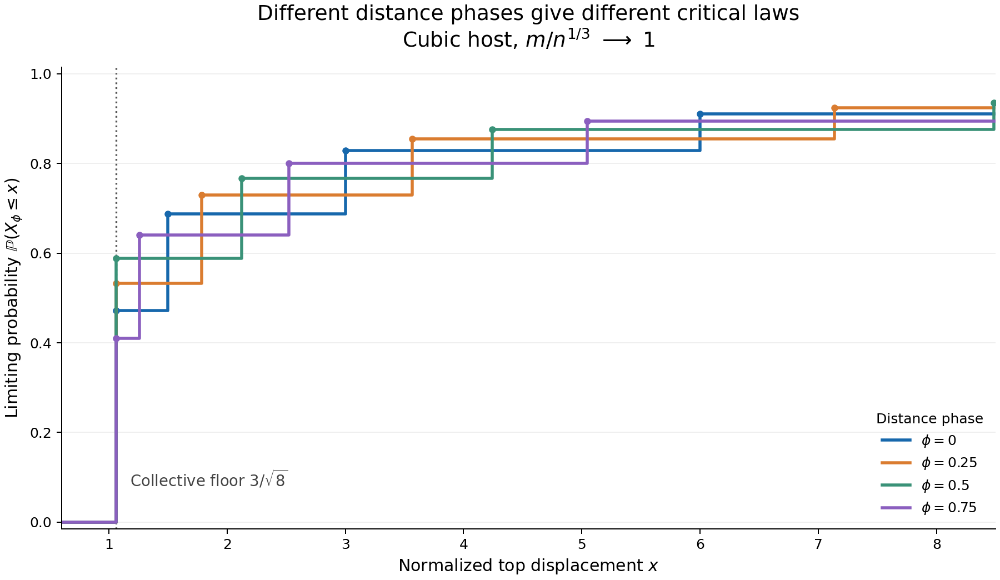

# Critical spectral law at the close-pair transition

November 15, 2026. The critical distribution is determined for predetermined neighbourhood duplications in a uniform simple random cubic graph. When m/n^(1/3) tends to c>0, integer distances survive in the spectrum. Different distance phases give different limiting laws. There is no single weak limit when n ranges through all admissible sizes.

The result extends to every fixed degree d>=3 with the critically weighted attachment B=sqrt(d-2)AE and H=0. Only degree three gives the simple unweighted duplication model. Canonical claims are SG-25 and SG-26 in the [claim ledger](../CLAIM_LEDGER.md).

## The explicit cubic law

Write s=sqrt(m/n) and phi_n for the fractional part of log_2(1/s). Along any subsequence with phi_n tending to phi, let the integer-indexed variables P_k be independent with

\[
P_k\sim\operatorname{Poisson}\!\left(\frac34c^{3/2}2^{k-\phi}\right).
\]

For the largest eigenvalue of the augmented graph,

\[
\frac{\lambda_{\max}-3}{s}
\xrightarrow{\mathrm d}
\max\left\{\frac3{\sqrt8},\ \sup_{k:P_k>0}\frac34\,2^{\phi-k}\right\}.
\]

The deterministic level is the collective mode. The random levels come from exceptionally close marked pairs. Each pair also contributes a linked negative displacement. The [full theorem](root/critical-law-v1.md) gives the limiting point measure away from zero and joint convergence of every fixed number of extreme eigenvalues at both ends of the near-d cluster.

The figure evaluates the proved limiting formula at c=1. It is not a finite-graph simulation. The [plot data](figures/critical-cdf-data.json) bind the proof revision. The [plot source](root/plot_critical_law.py) checks the geometric sum, values at lattice atoms, monotonicity and discrete scaling.

Phases zero and one represent the same law. All other phases give distinct laws, and the family is weakly continuous on this phase circle. Along any admissible size sequence, weak convergence of the normalized top is equivalent to convergence of its phase on that circle. Over all admissible sizes every phase occurs subsequentially. The limiting top has reciprocal-order tails and infinite mean.

## Proof and review record

| Component | Frozen proof | Review |
| --- | --- | --- |
| Marked-pair Poisson counts, short-path uniqueness and matching | [Pair-count theorem](probability/pair-counts-v1.md) | [Separate reconstruction](reviews/pair-counts-v1-review.md), [integrator audit](reviews/pair-counts-v1-integrator-review.md) |
| Approximation by collective modes and disjoint pair blocks | [Effective operator](root/effective-operator-v1.md) | [Separate reconstruction](reviews/effective-operator-v1-review.md) |
| Entire critical law, strict-inequality distribution formula and phase classification | [Critical law](root/critical-law-v1.md) | [Independent review](reviews/critical-law-independent-v1.md), [probability author's review](reviews/critical-law-by-probability-v1.md) |

The two full-law reviewers are distinct from its author. The probability author had developed the geometric premise, and the other reviewer had reviewed both component proofs. These are separate exact-revision audits with disclosed exposure, not blind independent discoveries. Both accept the frozen law without unresolved mathematical findings. A review filename collision was repaired by recovering the original bytes and verifying both hashes, as recorded in the [issue registry](ISSUE_REGISTRY.md).

The [evidence dependency record](EVIDENCE_DAG.json) binds inputs, dependencies, owners, artifacts and review targets. Its [check receipt](EVIDENCE_CHECK.json) passes 30 artifact checks and eight review-target bindings. Four [rejection controls](reviews/evidence-rejection-controls-v1.json) confirm that changed proofs, dependency cycles, unaccepted dependencies and absent reviews are rejected. These checks establish record consistency, not mathematical truth.

## Formalization and scope

The [formal packet](formalization/README.md) adds 30 checked finite theorem declarations. They construct the actual pair and collective matrices, explicit nonzero eigenvectors, eigenvalue coverage, the removed-coupling Euclidean norm bound and its normalized coefficient. Both the original source-only run and a separate fresh replay pass. The [scope review](reviews/formal-scope-v1.md) and [retained replay receipt](reviews/formal-replay-v1.json) state the exact encoded objects.

The probability limit, random-graph geometry, graph-to-matrix identification, analytic transfer, multiplicities and infinite-process convergence are not formalized. The declaration count is not a count of new research results. This is not an end-to-end formal random-graph theorem.

## Priority and significance

The [primary-source comparison](priority/PRIORITY-v1.md), [terminology check](priority/TERMINOLOGY-v1.md) and [final scope assessment](priority/FINAL_SCOPE-v1.md) distinguish the result from known lattice effects in graph distances, classical rare-event Poisson approximation, existing Poisson spectral-edge laws and max-semistable extreme-value distributions. No inspected source directly supplies this particular predetermined-mark critical spectral law. Historical firstness remains unverified, and no exact published open problem matching it was identified.

The structural contribution is the spectral reduction of the whole critical defect cluster to one collective mode and a geometric family of rare pair modes. It connects graph distance extremes with resonant spectral perturbations in this model. It does not yet establish a universal law across graph models, spatial localization, a normalized-Laplacian spectral gap or a mixing or solver consequence.

## Orchestration and next target

This round used the math-collaboration workflow and session-native delegated tasks. It did not execute the research_lab scheduler. The [capability inspection](root/ORCHESTRATION.md) explains why the archived adapter is not a drop-in controller for the available workers. This round implemented dependency and review checks inspired by its evidence design, without claiming to have run its scheduler.

The [handoff](HANDOFF.md) records exact revisions and completion evidence. The [next problem](NEXT_PROBLEM.md) asks for critical spectral subspace laws and the separate collective-pair resonance case. Multiplicities make subspaces the appropriate first target. No unattended run or external submission was started.
