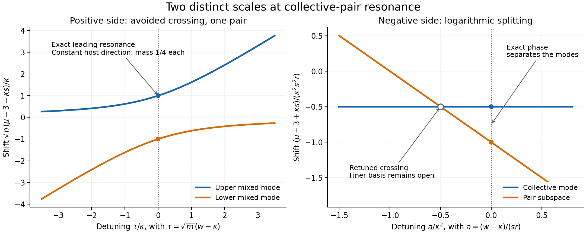

# Critical subspaces and two resonance scales

November 15, 2026. This round proves the critical spectral subspace theorem and resolves exact collective-pair resonance for predetermined neighbourhood duplications in a uniform simple cubic graph. The positive and negative sides behave differently. A still finer retuned negative crossing is explicitly left open.

The setting is H=0, m/n^(1/3)->c>0, s=sqrt(m/n), kappa=3/sqrt(8), r=floor(log_2(1/s)) and w=(3/4)2^(-r)/s. The first-order resonance is w->kappa, corresponding to distance phase 1/2. The number p of pairs at distance r tends to a Poisson variable of mean 3c^(3/2)/(4sqrt(2)).

## Subspaces, physical mass and spatial concentration

The [subspace theorem](root/subspaces-v1.md) identifies the actual graph spectral projection at every fixed nonzero critical level. It is close in operator norm to the physical lift of the appropriate pair modes and collective mode. This remains true when several pairs have the same limiting level and when a pair level collides with a collective level.

The physical lift is explicit:

\[
J(a,v)=\left(a u+R_Q(3)AEv/\sqrt8,\ v/\sqrt8\right).
\]

A canonical isometry onto the complete graph cluster is close to J. Its compressed adjacency agrees with the actual retained matrix to accuracy o_P(m^(-1/2)) in scaled coordinates. This supplies an eigenvector and subspace bridge, beyond an eigenvalue comparison.

At a pair level without a collective contribution, every unit vector in the level subspace has limiting masses (0,1/8,7/8) in the constant host direction, added vertices and perpendicular host component. The whole subspace concentrates near the union of the corresponding pair endpoints. The assertion does not force an individual vector to choose one pair. At a collision the combined subspace remains stable, while its internal basis needs finer spectral information.

## Positive avoided crossing

The [graph resonance theorem](root/graph-resonance-v2.md) gives that finer information. If sqrt(m)(w-kappa)->tau, conditional on p>=1, the two bright eigenvalues near 3+kappa s satisfy

\[
\sqrt n(\mu_\pm-3-\kappa s)
\longrightarrow
\frac{\tau\pm\sqrt{\tau^2+4\kappa^2p}}2.
\]

Their eigenvectors mix the collective direction with the symmetric aggregate of all p resonant pairs. The other p-1 directions form a grouped dark subspace. At tau=0, each bright graph eigenvector has masses

\[
(\text{constant host},\text{added},\text{perpendicular host})
=(1/4,3/32,21/32).
\]

The scale in the actual adjacency eigenvalues is n^(-1/2). All finite tau values can be achieved by admissible integer graph sizes and mark counts.

## Negative logarithmic splitting

Antisymmetric pair modes cancel the direct host-star coupling. They therefore need a finer analysis. Put a=(w-kappa)/(sr). When a has a finite limit, the eigenvalues near 3-kappa s have shifts at scale s squared r given by

\[
-\kappa^2/2\quad\text{for the collective sector},\qquad
-(a+\kappa^2)\quad\text{for the pair sector}.
\]

At exact phase 1/2, w=kappa and a=0. Consequently

\[
\mu_{\rm coll}=3-\kappa s-\frac{\kappa^2}{2}s^2r+o_P(s^2r),
\qquad
\mu_{\rm pair}=3-\kappa s-\kappa^2s^2r+o_P(s^2r).
\]

The negative collective and pair sectors are separated. Their mass triples are (1/2,1/16,7/16) and (0,1/8,7/8). This physical scale has order n^(-2/3)log n.

The collective drift comes from the stationary contribution of long walks. The additional pair drift comes from the energy-dependent normalization of the pair mode. Both corrections are needed. A finite star model alone gives an incorrect prediction at this precision.

The [figure data](figures/two-resonance-scales-data.json) bind the final theorem revision. The [generator](root/plot_resonance.py) passed 303 positive formula checks and three negative crossing and ordering checks. This is evaluation of the proved formulas, not a graph simulation.

The retuned value a=-kappa squared/2 produces a new coincidence at the logarithmic scale. The present theorem identifies its combined subspace but does not resolve the finer eigenvalue or eigenvector law there. Integer tuning realizes every finite a. For example, a=0 and a=-kappa squared have the same first-order phase and tau=0, yet the larger negative-window eigenvector has different limiting host mass when p=1. A phase-only individual-eigenvector law is therefore insufficient in the actual graph model.

## Proof and review map

| Component | Proof | Separate review |
| --- | --- | --- |
| Actual cluster isometry, level projections, mass operators and spatial concentration | [Subspaces](root/subspaces-v1.md) | [Subspace audit](reviews/subspaces-by-phase-v1.md) |
| Selected resolvent compression and column bounds | [Refined probability](probability/refined-resolvent-v1.md) | [Probability audit](reviews/refined-resolvent-by-phase-v1.md) |
| Equal-pair finite normal form and integer tuning | [Finite resonance](resonance/finite-normal-form-v1.md) | [Algebra reconstruction](reviews/finite-resonance-by-root-v1.md) |
| Stationary cancellation, pair metric and negative logarithmic scale | [Logarithmic probability](probability/negative-log-scale-v1.md) | [Separate reconstruction](reviews/negative-log-by-formal-v1.md) |
| Complete actual graph resonance, both scales and physical masses | [Graph theorem, revision 2](root/graph-resonance-v2.md) | [First application audit](reviews/graph-resonance-by-phase-v1.md), [probability author's application audit](reviews/graph-resonance-by-probability-v1.md) |

The graph theorem's revision 2 restores two missing additive signs in displayed remainders. Revision 1 is preserved. Reviews disclose prior exposure and bind exact target hashes. The proof authors and reviewers are distinguished in the [dependency record](EVIDENCE_DAG.json). Internal agreement is not a substitute for the arguments or a novelty certificate.

## Formalization, priority and remaining scope

The [formal packet](formalization/README.md) adds 24 finite declarations and separately replays 23 unchanged prior declarations. It proves actual coupled-matrix dark eigenvectors, an injective norm-preserving aggregate embedding and invariant range, determinant and basis-change identities, and explicit two-level eigenvectors. An [independent scope audit](reviews/formal-scope-v1.md) and [fresh replay receipt](reviews/formal-replay-v1.json) verify the packet. Probability, graph isometries, projection perturbation and physical mass limits remain paper proofs.

The [primary-source audit](priority/PRIORITY-v1.md) and [logarithmic-scale comparison](priority/LOG_SCALE-v1.md) credit established subspace perturbation, effective Hamiltonians and sparse spectral resonance theory. No inspected source directly supplies this fixed-cubic two-scale law. Historical firstness remains unverified. No claim of a universal graph-model law or a normalized-Laplacian mixing theorem is made.

The round used native delegated tasks and frozen evidence checks, not the research_lab scheduler. Prior frozen rounds remain unchanged. The [verification record](VERIFICATION.json) inventories the packet. The [handoff](HANDOFF.md) and [next problem](NEXT_PROBLEM.md) isolate the finer retuned negative crossing as the remaining target.
