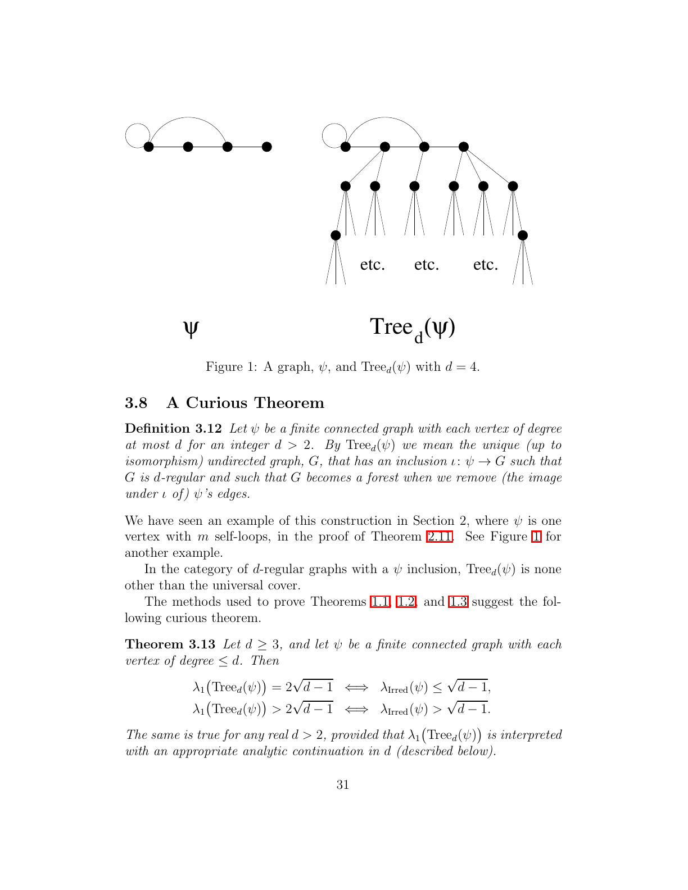
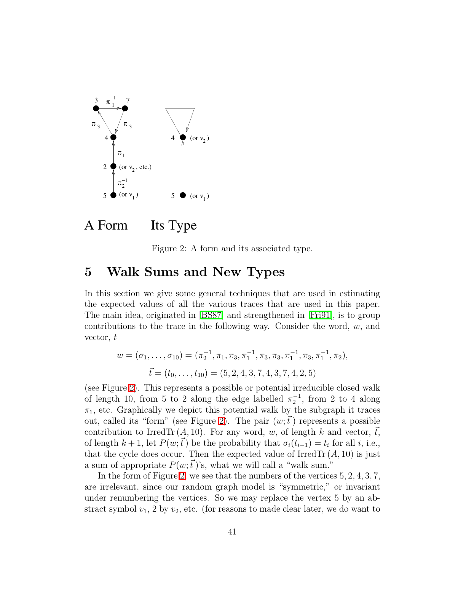

# Paper structure and visual inventory

## Reading architecture

The paper's 118 pages divide into motivation, technical infrastructure, selective expansion, spectral conversion, and final probability estimates. Section references below use the paper's numbering.

| Part | Sections and pages | Purpose | Read carefully or skim |
| --- | --- | --- | --- |
| Main claims | Section 1, pages 1 to 7 | Models, theorems, contiguity, reading routes | Read Theorems 1.1 to 1.3 and the proof outline carefully |
| Why ordinary traces fail | Section 2, pages 7 to 19 | Trace identities, d-Ramanujan functions, explicit tangle obstruction | Read Section 2.2 closely, especially Theorem 2.11 |
| Infrastructure | Section 3, pages 19 to 33 | Graph conventions, VLG, Perron growth, non-backtracking graphs, tree completion | Read definitions as needed and Theorem 3.13 closely |
| Tangles | Section 4, pages 33 to 40 | Spectral effect, order, occurrence probability, lower failure rate | Read Theorems 4.2, 4.7, and 4.13 |
| Walk combinatorics | Section 5, pages 41 to 58 | Walk sums, expansion polynomials, forms, types, new types | Read all definitions and Figure 2, skim loop examples on first pass |
| Selective traces | Section 6, pages 58 to 70 | Selectivity, decisive walk bound, model-specific $\tau_{\mathrm{fund}}$ | Theorem 6.6 is essential |
| Ramanujan functions | Section 7, pages 71 to 72 | Closure under convolution and motivation | Short, read before Section 8 |
| Selective expansion | Section 8, pages 73 to 80 | Arbitrary finite expansions with d-Ramanujan coefficients | Read the exponent comparison in Theorems 8.2 and 8.5 |
| Tangle strata | Section 9, pages 81 to 89 | Finiteness, Möbius inversion, expansion with and without tangles | Theorem 9.3 and Corollary 9.4 are essential |
| Strong traces | Section 10, pages 89 to 94 | Pure power-sum spectral identity | Read Theorem 10.3 and Lemma 10.4 |
| Sidestepping | Section 11, pages 94 to 99 | Discard large normalized spectral defects without knowing coefficients | Lemma 11.1 is essential |
| Spreading | Section 12, pages 99 to 105 | A priori separation from degree $d$ in all models | Read statements and the factorial exponent mechanism |
| Final proof | Section 13, pages 106 to 108 | Choose tangles, trace length, and error order | Read every step |
| Other models | Section 14, pages 108 to 112 | Six sufficient model properties and transfers | Read the checklist, then model-specific details as needed |
| Limits and lookup | Section 15, pages 112 to 113, glossary 113 to 115 | Open problems and definitions | Read closing limitations, use glossary for reference |
| References | Pages 116 to 118 | Bibliography | Reference only |

## Section-by-section map

### Section 1: Introduction

- **Purpose:** State the near-Ramanujan target and four random models, define domination, and preview selective traces.
- **Key definitions and claims:** $\mathcal G_{n,d}$, $\mathcal H_{n,d}$, $\mathcal I_{n,d}$, $\mathcal J_{n,d}$, Theorems 1.1 to 1.3, Corollary 1.4.
- **Dependencies:** Alon-Boppana for optimality, external contiguity for model transfer.
- **Visuals:** None beyond typeset equations.
- **Caution:** Theorem 1.3's $\mathcal J_{n,d}$ exponents need to be read beside Theorems 4.13 and 6.12.

### Section 2: Problems with the standard trace method

- **Subsection 2.1:** Derives or cites adjacency-to-irreducible trace relations and d-Ramanujan expansions. Lemma 2.4 transfers the regular-tree norm to reduction counts $N_{k,i}$.
- **Subsection 2.2:** Shows that local loops cause a large $\lambda_2$ with polynomial probability. Theorem 2.12 shows ordinary coefficients eventually fail to be d-Ramanujan.
- **Must read:** Theorem 2.11's test function on $\operatorname{Tree}_d(\psi)$ and the distinction between expectation and at-least-one occurrence.
- **Visuals:** No formal figure, but the loop-based radial test function is the example revisited visually in Figure 1.
- **Source defect:** Page 12's displayed $q_k(d)=(d-1)^k$ conflicts with the recurrence. See the weak-points file.

### Section 3: Background and terminology

- **Subsections 3.1 and 3.2:** Labelled pseudographs, whole-loops, half-loops, VLG, subdivision, realization, suppression.
- **Subsections 3.3 to 3.5:** Perron values, Shannon generating functions, radius of convergence, limiting edge lengths.
- **Subsections 3.6 and 3.7:** $G_{\mathrm{Irred}}$, strong connectivity, infinite graph norm equals closed-walk growth.
- **Subsection 3.8:** Defines $\operatorname{Tree}_d(\psi)$ and proves the threshold equivalence in Theorem 3.13.
- **Visuals:** Figure 1 on page 31 is the only figure in this part.
- **Skimmable on first pass:** The infinite counterexamples after Theorem 3.5, provided their cautions are remembered.

### Section 4: Tangles

- **Purpose:** Define tangle occurrence, criticality, and order, and compute occurrence probabilities.
- **Key dependencies:** Theorem 3.13 converts $\lambda_{\mathrm{Irred}}$ to the tree-completion norm. Theorem 4.2 combines a finite test function with Courant-Fischer.
- **Core claims:** Theorem 4.7 gives expectation $n^{-\operatorname{ord}(\psi)}+O(n^{-\operatorname{ord}(\psi)-1})$ and a lower probability using pruning and automorphisms. Theorem 4.13 handles the lower failure exponents in other models.
- **Visuals:** None. The various automorphic tangles are described verbally or algebraically.

### Section 5: Walk sums and new types

- **Subsection 5.1:** Defines potential walks, SSIIC collections, expansion polynomials, and the generic error $O(k^{4r}(d-1)^k/n^r)$.
- **Subsection 5.2:** Uses simple loops to demonstrate d-Ramanujan word sums and divisor sums.
- **Subsection 5.3:** Defines forms, types, lettering, and new types.
- **Subsection 5.4:** Explains why old types fail and why selective new types should repair convergence.
- **Visuals:** Figure 2 on page 41 is essential to the definition of suppression and first-visit numbering.
- **Read carefully:** The difference between $m_i$, the number of traversals of a type edge, and $k_i$, the beaded length of that edge.

### Section 6: The selective trace

- **Subsections 6.1 and 6.2:** Define selective walks and prove Theorem 6.6 via generating function majorants.
- **Subsections 6.3 and 6.4:** Compute $\tau_{\mathrm{fund}}$ using pruning, contractions, and explicit extremal tangles.
- **Visuals:** None. Equation 30 is a $2\times2$ transition matrix for a $d=6$ tangle and is treated in the derivations.
- **Caution:** Theorem 6.10's matrix root wording and Theorem 6.12's relation to Theorem 1.3 need the corrections and cautions documented in the weak-points file.

### Sections 7 and 8: Ramanujan functions and expansions

- **Section 7:** Defines order $\alpha$ and proves closure under convolution.
- **Section 8:** Theorem 8.1 gives the selective trace expansion. Theorem 8.2 isolates new-type sums, Theorem 8.5 estimates those sums, and Lemma 8.8 controls infinite polynomial tails.
- **Visuals:** None. The important picture is algebraic, comparing $(\sqrt{d-1}-\eta)^{BM_1+M_2}$ with $(d-1)^{-(BM_1+M_2)/2}$.
- **Must read:** How bounded polynomial degree permits summation over all $M_1,M_2$.

### Section 9: Selective traces with and without tangles

- **Purpose:** Expand selective trace expectations on events where tangles occur, then subtract to handle tangle-free graphs.
- **Key claims:** Lemma 9.2, Theorem 9.3, Corollary 9.4, Proposition 9.5.
- **Technical additions:** Derived tangles $\Psi^+$, $\Omega$-forms, $\Omega$-types, Möbius weights $\mu_\Omega$.
- **Visuals:** None. Overlaps are represented by graph union operations, not a diagram.
- **Caution:** Lemma 9.2's last inclusion direction is reversed in print.

### Section 10: Strongly irreducible traces

- **Purpose:** Replace Chebyshev trace functions by direct power sums of $\mu_{1,2}(\lambda)$ and $\pm1$.
- **Key claims:** Theorem 10.3, Lemma 10.4, Theorem 10.5.
- **Visuals:** None. Theorem 10.3's root pairs and sign contributions are equations.
- **Why later sections need it:** A finite difference in $k$ now produces $(-\theta)^s(1-\theta)^k$ directly.

### Section 11: A sidestepping lemma

- **Purpose:** Infer bounds on $\theta_i$ bounded away from zero without identifying $p_j(k)$.
- **Steps:** Apply $(\sigma_k-1)^s$, compare two trace lengths, split $\theta$ into small, intermediate, and large bands, use Taylor expansion for small $\theta$, then extend polynomial bounds backward with Sublemma 11.2.
- **Visuals:** None. The three bands $A_1,A_2,A_3$ are logical partitions, not a plotted spectral diagram.
- **Must read:** Why $|1-\theta|\leq1$ and reality outside a modulus threshold control complex terms.

### Section 12: Magnification theorems

- **Purpose:** Prove fixed spread and nontrivial spectral separation with failure $O(n^{-\tau_{\mathrm{fund}}})$.
- **Key claims:** Theorems 12.2, 12.3, and 12.4.
- **Technique:** Count ways a permutation can map $A$ into a slightly larger $B$, then compare multinomial entropy and factorial probability exponents.
- **Visuals:** No figure. The set partition $C_1=A\cap B$, $C_2=A\setminus B$, $C_3=B\setminus A$ is algebraic.

### Section 13: Finishing the $\mathcal G_{n,d}$ proof

- **Purpose:** Combine tangle-free expansion, strong trace spectrum, sidestepping, and spreading.
- **Key choice:** $k=2\lceil r\log n/(3\log(d-1))\rceil$, then $r$ large enough to beat $\tau_{\mathrm{fund}}$.
- **Complex spectrum:** Conjugate nonreal $\mu$ pairs can be bounded below by $-2(n-1)(d-1)^{k/2}$ for even $k$.
- **Visuals:** None.

### Section 14: Finishing proofs for the other models

- **Purpose:** Isolate six sufficient model properties: labelling, coincidence, expansion with error, simple word sum, $\tau_{\mathrm{fund}}$, and spreading.
- **New calculations:** Odd factorials for matchings, involution adjustments for half-loops, word-sum spectra of complete non-backtracking transition graphs.
- **Visuals:** None.
- **Caution:** This section confirms that $\mathcal I_{n,d}$ and $\mathcal J_{n,d}$ share the same $\tau_{\mathrm{fund}}$ for spreading.

### Section 15, glossary, references

- **Closing limitations:** $\epsilon=0$, negative $\epsilon(n)$, critical-tangle gaps, relative Alon conjecture, and understanding selectivity directly.
- **Glossary:** Pages 113 to 115 list definitions and page references.
- **Visuals:** None. These are typographic lists, not tables carrying data or additional argument.

# Complete visual inventory

The TeX source has exactly two figure environments, `dtree.eps` and `form1.eps`. It has no `table` environment and no experimental data asset. Both PDF pages were rendered and inspected. Small red and green rectangles visible around PDF cross-references are link decorations, not mathematical annotations.

## Figure 1, page 31: $\psi$ and $\operatorname{Tree}_d(\psi)$ for $d=4$

### What is drawn

**Paper.** The left object $\psi$ has four marked vertices. Its leftmost vertex has one whole-loop and participates in a path and an arch. The arch joins the first and third vertices. The right object repeats this core and attaches downward tree branches. The strings `etc.` indicate infinite continuation.

**Derived count.** Reading whole-loop degree as 2, the four core vertices have degrees $4,2,3,1$ in $\psi$. To make each degree 4, the completion therefore needs respectively $0,2,1,3$ new branches. The drawn right side visibly follows this pattern. This is a useful check that the picture really encodes the definition rather than generic tree decoration.

### What the visual encodes

- **Black disks:** Actual vertices shown in the finite excerpt.
- **Whole-loop and arches:** Edges already present in $\psi$, preserved in the completion.
- **Downward thin lines:** Added tree branches with no new cycles.
- **`etc.`:** The branches continue forever, so no finite spectral radius can be read off by counting the picture.
- **No arrows or labels on added edges:** Tree completion is unlabelled in this theorem. Non-backtracking growth is discussed through the adjacency and edge graph, not through a displayed random model.

### Main pattern and mechanism

The finite core creates a local spectral defect. Everything outside the core is as close to a regular tree as possible. Theorem 3.13 then compares two thresholds:

$$
\lambda_1(\operatorname{Tree}_d(\psi))>2\sqrt{d-1}
\quad\Longleftrightarrow\quad
\lambda_{\mathrm{Irred}}(\psi)>\sqrt{d-1}.
$$

The picture explains why only $\psi$ needs to be analyzed. Repeated tree arms contribute the universal baseline, while core structure determines any excess.

### Role in the argument

Theorem 4.2 later places a finitely supported approximate eigenfunction from this infinite completion into any large graph containing $\psi$. A second test function supported on the complement then gives a lower bound for $\lambda_2$. Thus Figure 1 is directly connected to the tangle obstruction, not an ornamental example.

### Ambiguity or misuse to avoid

This is not a picture of a random graph on $n$ vertices and not evidence that an infinite tree must appear as a subgraph. The finite graph need only contain $\psi$. The tree completion is a universal object used to build a bounded test function. The figure also does not distinguish critical from hypercritical tangles, which requires computation of $\lambda_{\mathrm{Irred}}$.

## Figure 2, page 41: A form and its associated type

### Reconstructing the traced walk

**Paper.** The displayed word and vertex vector are

$$
w=(\pi_2^{-1},\pi_1,\pi_3,\pi_1^{-1},\pi_3,\pi_3,\pi_1^{-1},\pi_3,\pi_1^{-1},\pi_2),
$$

$$
\vec t=(5,2,4,3,7,4,3,7,4,2,5).
$$

**Derived trace check.** The ten steps are:

1. $5\xrightarrow{\pi_2^{-1}}2$.
2. $2\xrightarrow{\pi_1}4$.
3. $4\xrightarrow{\pi_3}3$.
4. $3\xrightarrow{\pi_1^{-1}}7$.
5. $7\xrightarrow{\pi_3}4$.
6. $4\xrightarrow{\pi_3}3$ again.
7. $3\xrightarrow{\pi_1^{-1}}7$ again.
8. $7\xrightarrow{\pi_3}4$ again.
9. $4\xrightarrow{\pi_1^{-1}}2$.
10. $2\xrightarrow{\pi_2}5$.

The left drawing matches those five distinct undirected edges. The triangular cycle is traversed twice in immediate succession. This repetition is visible in the word and vector, not by drawing duplicate lines.

### Form versus type

- **Form, left:** Keeps labelled directed edges and numbered visited vertices. Five vertices and five distinct undirected edges give $\operatorname{ord}=5-5=0$.
- **Suppressed vertices:** $2,3,7$ are degree-two beads and are not the starting vertex. They lose their marked identities in the type.
- **Retained vertices:** Starting vertex $5$ and branching vertex $4$ remain marked.
- **Type, right:** Has two surviving vertices and two compressed undirected edges. Its order remains $2-2=0$.
- **Compressed $5$ to $4$ edge:** Label $\pi_2^{-1}\pi_1$, length 2, traversed once in each direction.
- **Compressed loop at $4$:** Label $\pi_3\pi_1^{-1}\pi_3$, length 3, traversed twice.

The apparent triangular outline on the right is therefore a visual remnant of the length-three path. It should not be mistaken for three separately labelled type edges. The type's compressed length and label data are explained in text rather than printed on the drawing.

### Main takeaway

One graph encoding cannot serve every purpose. The form determines factorial probabilities and traversal legality. The type suppresses combinatorially uninteresting beads so sums can be organized by Perron growth. A new type will later add fixed labels and lengths on short edges and mark other edges long. Figure 2 does **not** show those later decorations.

### Ambiguity

The adjacent text proposes abstract names by first visit, which would make $5\mapsto v_1$, $2\mapsto v_2$, $4\mapsto v_3$, $3\mapsto v_4$, and $7\mapsto v_5$. The drawing instead shows `4 (or v2)`. This is coherent if $v_2$ refers to the second surviving vertex of the compressed type, but not if read as first-visit numbering in the original form. Treat it as a diagram numbering ambiguity, not a change in the walk.

### Role in later claims

This example makes Definition 5.13 concrete and explains Equation 23:

$$
\mathbb E[\Gamma]_n
=\frac{n!}{(n-v)!}\prod_{j=1}^{d/2}\frac{(n-a_j)!}{n!}.
$$

More importantly, it shows why walk growth can be computed after compression without losing non-backtracking information. This is the combinatorial entry to Theorem 6.6.

## Other visual and non-text elements

- Displayed matrices, transition arrays, polynomial formulas, and determinant identities are substantive mathematics and are treated in `05-main-results.md` and `06-derivations.md`. They are not separate raster images.
- The glossary and bibliography are formatted lists, not data tables requiring trend interpretation.
- There are no scatterplots, histograms, empirical curves, simulation outputs, datasets, or experimental tables. The numerical experiments mentioned in Section 15 are not presented with numerical values or visual evidence.
- No substantive visual was left uninspected.
