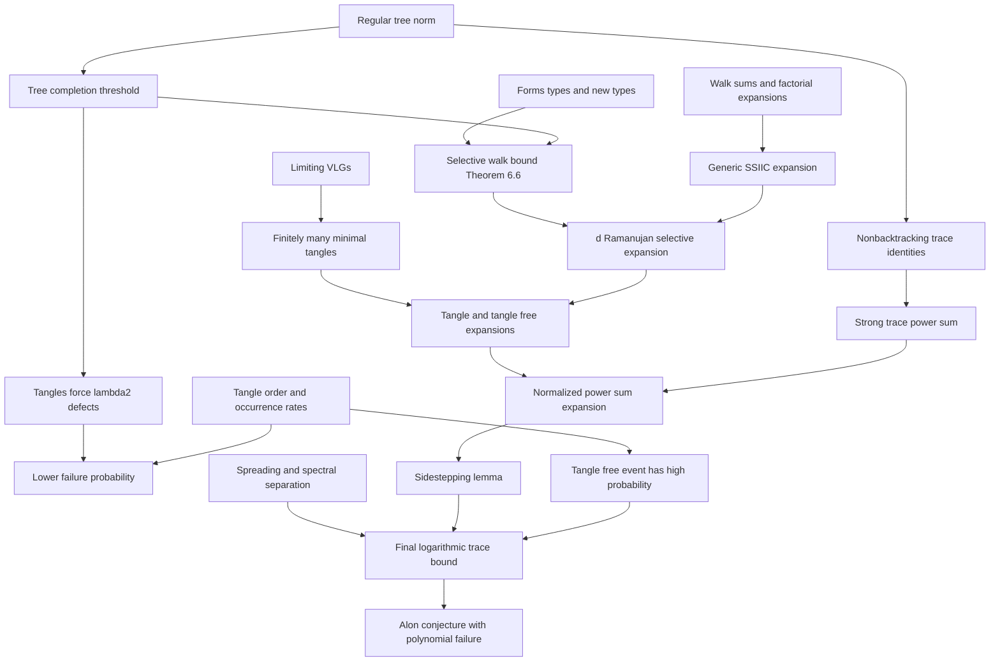

# Main results and dependencies

Statements below paraphrase the supplied arXiv v1 text. Constants may depend on fixed $d$, $\epsilon$, and chosen expansion order. The notes do not silently correct inconsistent source statements, those issues are flagged separately.

## R1. Alon's conjecture for $\mathcal G_{n,d}$

**Paper, Theorem 1.1, pages 2 and 3.** Let $d\geq4$ be even and $\epsilon>0$. For $G$ formed from $d/2$ independent uniform permutations,

$$
\Pr\!\left[\max_{i>1}|\lambda_i(G)|\leq2\sqrt{d-1}+\epsilon\right]
\geq1-cn^{-\tau_{\mathrm{fund}}},
$$

with

$$
\tau_{\mathrm{fund}}
=\left\lceil\frac{\sqrt{d-1}+1}{2}\right\rceil-1.
$$

Also, for a constant $c'>0$ and $s=\lfloor(\sqrt{d-1}+1)/2\rfloor$,

$$
\Pr\!\left[\lambda_2(G)>2\sqrt{d-1}\right]\geq c'n^{-s}.
$$

- **Formal assumptions:** Fixed even degree and independent uniform permutations. Loops and multiple edges are allowed.
- **Upper bound dependencies:** Theorems 6.6, 8.1, 9.3, 10.3, Lemma 11.1, Theorems 12.2 and 12.3, final Section 13.
- **Lower bound dependencies:** Theorems 2.11 and 4.7, a hypercritical loop tangle.
- **Meaning:** Typical spectra approach the Ramanujan bound in every nontrivial direction. Spectral failure has polynomial probability, and a comparable polynomial probability lower bound comes from explicit finite tangles.
- **Contribution:** This is the main theorem of the paper.

## R2. Other explicit random regular models

**Paper, Theorems 1.2, 1.3, 6.10 to 6.12.**

For $\mathcal H_{n,d}$ and $\mathcal I_{n,d}$, the model-specific computations give

$$
\tau_{\mathrm{fund}}=\left\lceil\sqrt{d-1}\right\rceil-1,
\qquad s=\left\lfloor\sqrt{d-1}\right\rfloor,
$$

with special exceptions or alternative tangles described in Theorem 4.13 for $\mathcal H_{n,4}$. For $\mathcal J_{n,d}$, Theorem 6.12 also proves $\tau_{\mathrm{fund}}=\lceil\sqrt{d-1}\rceil-1$, and Theorem 4.13 uses $s=\lfloor\sqrt{d-1}\rfloor$.

- **Model assumptions:** $\mathcal H_{n,d}$ uses $n$-cycles, $\mathcal I_{n,d}$ uses perfect matchings with $n$ even, and $\mathcal J_{n,d}$ uses near-perfect matchings with half-loops and $n$ odd.
- **Proof dependencies:** The six-item checklist in Section 14, plus the corresponding word and factorial expansions.
- **Meaning:** Odd degrees are covered by matching models, and the proof is not an artifact of one permutation ensemble.
- **Source caution:** Theorem 1.3 imports the $\mathcal G_{n,d}$ statement for $\mathcal J_{n,d}$, including its smaller exponents. That statement has not been reconciled with the model-specific lower bound in this version.

## R3. Transfer by domination

**Paper, Corollary 1.4, page 4.** If a family $\mathcal L_n$ of $d$-regular graph measures is dominated by one of the four explicit model families, then for every fixed $\epsilon>0$,

$$
\Pr_{\mathcal L_n}\!\left[\max_{i>1}|\lambda_i|>2\sqrt{d-1}+\epsilon\right]\to0.
$$

- **Dependencies:** Definition of domination and any explicit model's bad event tending to zero.
- **Meaning:** This includes routes to configuration-model and uniform simple random regular graphs via contiguity results cited from other work.
- **Limit:** Domination preserves vanishing probability, not a specific polynomial exponent or its implicit constant.

## R4. Standard trace machinery

**Paper, Lemmas 2.3 and 2.4, Theorems 2.7 and 2.8, pages 10 to 14.**

The non-backtracking walk matrices satisfy

$$
A_1=A,\qquad A_2=A^2-dI,
$$

$$
A_k=AA_{k-1}-(d-1)A_{k-2}\quad(k\geq3).
$$

If enough functions $g_i(k)$ in the expected irreducible trace expansion are d-Ramanujan, then higher principal terms vanish and one obtains a nontrivial eigenvalue bound of shape

$$
2\sqrt{d-1}\left(\frac d{2\sqrt{d-1}}\right)^{1/(r+1)}
\left(1+O\!\left(\frac{\log\log n}{\log n}\right)\right).
$$

- **Formal assumptions:** The d-Ramanujan expansion is available only through finite $r$, and a priori spectral separation holds.
- **Meaning:** More d-Ramanujan coefficients bring the bound closer to $2\sqrt{d-1}$.
- **Contribution:** Explains why the new proof aims for expansions of arbitrary finite order.

## R5. Why the ordinary expansion breaks

**Paper, Theorems 2.10 to 2.12, pages 16 to 19.**

A vertex with $m$ whole-loops has a tree-completion test value

$$
\alpha(m)=2m-1+\frac{d-1}{2m-1}>2\sqrt{d-1}
$$

when $2m-1>\sqrt{d-1}$. Such a fixed local pattern forces $\lambda_2>2\sqrt{d-1}$ for sufficiently large $n$ and occurs with probability at least $n^{1-m}-\frac12n^{2-2m}$ in the explicit construction. Theorem 2.12 concludes that the ordinary $g_i$ cannot all remain d-Ramanujan up to an order $O(\sqrt d\log d)$.

- **Dependencies:** Tree norm, Rayleigh quotients, inclusion-exclusion.
- **Meaning:** The obstruction is visible in finite subgraphs and has nonzero polynomial probability.
- **Contribution:** Identifies exactly what selective traces must suppress.

## R6. Tree completion threshold

**Paper, Theorem 3.13, pages 31 to 33.** For finite connected $\psi$ with degrees at most $d$,

$$
\lambda_1(\operatorname{Tree}_d(\psi))=2\sqrt{d-1}
\iff
\lambda_{\mathrm{Irred}}(\psi)\leq\sqrt{d-1},
$$

and

$$
\lambda_1(\operatorname{Tree}_d(\psi))>2\sqrt{d-1}
\iff
\lambda_{\mathrm{Irred}}(\psi)>\sqrt{d-1}.
$$

- **Dependencies:** Shannon generating function, the first-return series $S_d$, Ihara-Bass, Perron convergence.
- **Meaning:** Local non-backtracking growth predicts whether completion beats the infinite regular-tree norm.
- **Visual support:** Figure 1 shows how only the finite core and its forest attachments enter the construction.

## R7. Tangles force spectral defects and occur at order-based rates

**Paper, Theorems 4.2 and 4.7, pages 34 to 39.**

If an $n$-vertex graph contains fixed $\psi$, then

$$
\lambda_2(G)\geq\|A_{\operatorname{Tree}_d(\psi)}\|-o(1).
$$

For a fixed tangle $\psi$ of nonnegative order $r=\operatorname{ord}(\psi)$ in $\mathcal G_{n,d}$,

$$
\mathbb E[\#\{\psi\text{ inclusions}\}]=n^{-r}+O(n^{-r-1}),
$$

and at least one occurrence has probability bounded below by the displayed inclusion-exclusion expression involving pruning and automorphisms.

- **Dependencies:** Theorem 3.13, finite-support test functions, label-preserving factorial counts, order monotonicity under inclusion.
- **Meaning:** Hypercritical tangles imply a strict Ramanujan violation, and small-order tangles are the most frequent obstruction.
- **Limit:** The lower failure statement concerns hypercritical tangles, whereas $\tau_{\mathrm{fund}}$ is defined using the larger supercritical class.

## R8. Generic walk-sum expansion

**Paper, Theorems 5.5 and 5.9, pages 45 to 49.** For a symmetric size-invariant irreducible closed collection,

$$
\operatorname{WalkSum}(\mathcal W,k,n)
=f_0(k)+\frac{f_1(k)}n+\cdots+\frac{f_{r-1}(k)}{n^{r-1}}
+\frac{\operatorname{error}}{n^r},
$$

with, for $k\leq n/2$,

$$
|\operatorname{error}|\leq ck^{4r}(d-1)^k.
$$

The leading term associated to a form is

$$
\mathbb E[\Gamma]_n
=\frac{n!}{(n-v)!}\prod_{j=1}^{d/2}\frac{(n-a_j)!}{n!}
=n^{v-e}(1+O(n^{-1})).
$$

- **Dependencies:** Relabelling symmetry, factorial expansion, coincidence counting.
- **Meaning:** $e-v$ determines the $1/n$ order, and fixed-$k$ combinatorics yields polynomial coefficients.
- **Limit:** The generic theorem does not say the $f_i$ are d-Ramanujan. That requires selectivity.

## R9. Decisive selective walk bound

**Paper, Theorem 6.6, pages 61 to 64.** For a fixed new type with $B>S$ sufficiently large, there are $c,\eta>0$ such that

$$
W_{\widetilde T,S}(M_1,M_2)
\leq c(\sqrt{d-1}-\eta)^{(S_0+1)M_1+M_2}
\leq c(\sqrt{d-1}-\eta)^{BM_1+M_2}.
$$

Here $\Psi$ contains every supercritical tangle that can occur in the type.

- **Dependencies:** Perron growth on fixed subgraphs, finiteness of extreme VLG majorants, alternating long and fixed subwalk decomposition, generating function convergence.
- **Meaning:** Selectivity makes walk enumeration strictly subcritical at the squared Ramanujan scale. Long edges strengthen the decay by $B$ per traversal.
- **Contribution:** This is the technical heart of the proof.

## R10. Arbitrary finite selective expansions

**Paper, Theorem 8.1, page 73.** If $\Psi$ contains every supercritical tangle of order below $r$, then for $S$ sufficiently large,

$$
\mathbb E[\operatorname{IrSelTr}_{S,\Psi}(G,k)]
=f_0(k)+\frac{f_1(k)}n+\cdots+\frac{f_{r-1}(k)}{n^{r-1}}
+\frac{\operatorname{error}}{n^r},
$$

where every $f_i$ is d-Ramanujan and the generic error estimate applies.

- **Dependencies:** Theorems 5.9, 6.6, 8.2, 8.3, 8.5, and Lemma 8.8.
- **Meaning:** Each coefficient takes the form $(d-1)^kp(k)$ plus error at most $ck^c(d-1)^{k/2}$.
- **Limit:** The expansion is conditional on the chosen selective walk class and says nothing directly about the discarded walks.

## R11. Expansion on tangle and tangle-free strata

**Paper, Lemma 9.2, Theorem 9.3, Corollary 9.4, pages 81 to 89.**

- $\Psi_{\min}[r]$ is finite.
- For finite pruned $\Psi$ of order at least 1, $\mathbb E[\chi_\Psi\operatorname{IrSelTr}]$ has a d-Ramanujan expansion to arbitrary finite order.
- Subtracting from Theorem 8.1 gives the same kind of expansion for $\mathbb E[(1-\chi_\Psi)\operatorname{IrSelTr}]$.

- **Dependencies:** Limiting VLGs, generalized Möbius inversion, $\Omega$-types, coincidence truncation, Theorem 8.1.
- **Meaning:** On the tangle-free event the selective trace equals the ordinary trace, so this is enough to analyze the actual spectrum on a high-probability stratum.
- **Formal restriction:** Theorem 9.3 assumes order at least 1. Cycles of order 0 are explicitly left unresolved in that theorem.

## R12. Strongly irreducible spectral identity

**Paper, Theorem 10.3, pages 90 to 93.** With $\mu_{1,2}$ solving $\mu^2-\lambda\mu+(d-1)=0$,

$$
\operatorname{SIT}(G,k)
=\sum_{i=1}^n\left(\mu_1(\lambda_i)^k+\mu_2(\lambda_i)^k
+(1+(-1)^k)\frac{d-2}2\right)
$$

for graphs without half-loops. For even $k$ this is a pure power sum over $nd$ spectral numbers $\nu_i$.

- **Dependencies:** $G_{\mathrm{Irred}}$, Lemma 10.4, the recurrence annihilator $(\sigma_k^2-1)(\sigma_k^2-\lambda\sigma_k+d-1)$.
- **Meaning:** Nonreal roots have modulus $\sqrt{d-1}$, and a real outlier above that modulus detects an adjacency eigenvalue above $2\sqrt{d-1}$.
- **Why essential:** It turns Section 11 into ordinary finite differences of power sums.

## R13. Sidestepping unknown coefficients

**Paper, Lemma 11.1, pages 94 to 99.** Under the normalization conditions on $\theta_i$ and a polynomial-plus-error expansion for $\mathbb E\sum_i(1-\theta_i)^k$,

$$
\mathbb E\sum_i\chi_{\{|\theta_i|>\log^{-2}n\}}(1-\theta_i)^k
=O\!\left(Dn^{1-r/3}+k^c(d-1)^{-k/2}\right)
$$

for $k\leq n^\gamma$ with some $\gamma>0$.

- **Dependencies:** Finite differences, Taylor expansion in a small-$\theta$ band, comparison of two powers, backward extension of polynomial bounds.
- **Meaning:** Unknown $p_j(k)$ need not be determined to remove spectrally dangerous terms.
- **Main assumption:** $|1-\theta_i|\leq1$, and $\theta_i$ is real whenever $|1-\theta_i|>(d-1)^{-1/2}$.

## R14. Spreading and a priori separation

**Paper, Theorems 12.2 to 12.4, pages 99 to 105.** Each model is a fixed $\gamma$-spreader with probability $1-O(n^{-\tau_{\mathrm{fund}}})$, for suitable $\gamma>0$. Consequently every nontrivial adjacency eigenvalue satisfies

$$
\lambda_i^2\leq d^2-\frac{\gamma^2}{4+2\gamma^2}
$$

on that event.

- **Dependencies:** Alon's magnification bound, permutation and matching factorial count, small-set exclusion using supercritical tangles.
- **Meaning:** All non-Perron $\mu$ are bounded away from $d-1$, allowing the final trace estimate to focus on outliers beyond $e^\eta\sqrt{d-1}$.

## R15. Final probability calculation

**Paper, Section 13, pages 106 to 108.** Choose $\Psi'$ as supercritical tangles of order below $r$ and $\Psi=\Psi_{\min}[r-1]$. On $\chi_\Psi=0$, selective and ordinary strong traces agree. The sidestepping lemma controls normalized $\mu$ below $(d-1)(1-\log^{-2}n)$. With

$$
k=2\left\lceil\frac{r\log n}{3\log(d-1)}\right\rceil,
$$

an outlier of size $e^\eta\sqrt{d-1}$ has probability bounded by roughly $n^{1-\alpha r}$, where $\alpha=2\eta/(3\log(d-1))$. Taking $r$ sufficiently large makes this $O(n^{-\tau_{\mathrm{fund}}})$. Spreading accounts for the complementary event.

- **Meaning:** A fixed $\epsilon$ in adjacency scale corresponds to a fixed $\eta>0$ in non-backtracking scale.
- **Limit:** As $\epsilon\to0$, $\eta\to0$, so the required expansion order and constants are not uniform in a way that would prove the $\epsilon=0$ theorem.

# Dependency graph

## Fast correction-free reading route

For a first proof pass, use Theorems 1.1, 3.13, 4.2, 5.9, 6.6, 8.1, 9.3, 10.3, 11.1, 12.3, and Section 13. Read Section 2 when asking why selectivity is necessary, Section 4 when asking why polynomial rates arise, and Section 14 when changing the random graph model.
