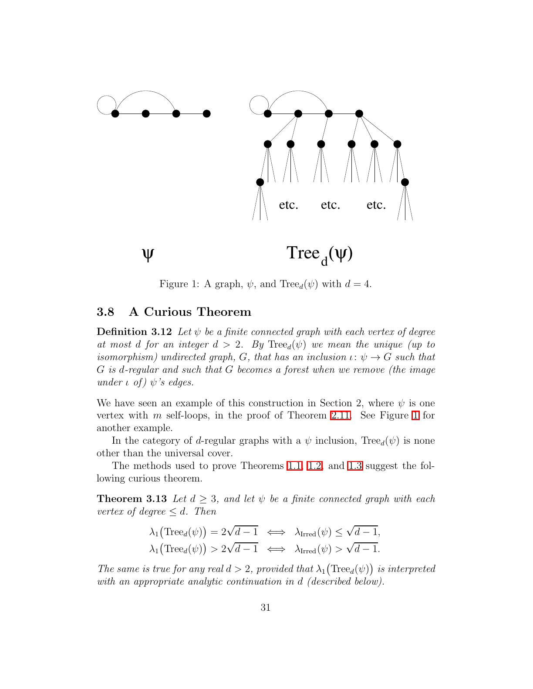
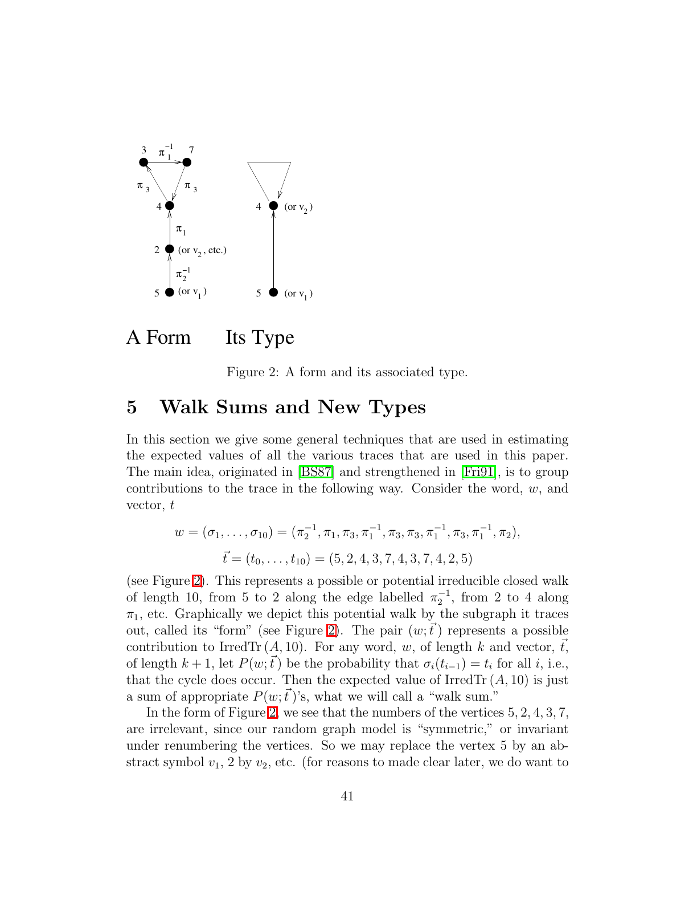

# Friedman, Alon's second eigenvalue conjecture

A comprehension dossier for Joel Friedman's 118-page arXiv paper `cs/0405020v1`.

## Start here

1. [Executive map](01-executive-map.md) for the problem and proof mechanism.
2. [Paper structure and visual inventory](04-paper-structure.md) for section navigation and both figure explanations.
3. [Main results](05-main-results.md) for formal claims and dependencies.
4. [Central derivations](06-derivations.md) for expanded mathematical arguments.
5. [Assumptions and weak points](09-assumptions-and-weak-points.md) for hypotheses, limits, and source defects.

## Supporting notes

- [Source and reading coverage](SOURCE.md)
- [Current status](00-status.md)
- [Prerequisites](02-prerequisites.md)
- [Notation](03-notation.md)
- [Reusable techniques](07-techniques.md)
- [Intuition at several altitudes](08-intuition.md)

## Visuals

The paper has two substantive figures and no data tables or experimental plots.

Both figures are mathematical diagrams. Their geometry, arrows, omissions, and roles in adjacent proofs are analyzed in `04-paper-structure.md` and `06-derivations.md`.

## Reading route

For the main $\mathcal G_{n,d}$ result, start with Sections 1, 5, 6, 8, 9, 10, 11, 12, and 13. Use Sections 2 and 4 to understand the failure probability and tangle mechanism. Section 3 supplies VLG and infinite graph machinery. Section 14 transfers the proof to $\mathcal H_{n,d}$, $\mathcal I_{n,d}$, and $\mathcal J_{n,d}$. The glossary on pages 113 to 115 is useful for terminology but contains no new argument.
