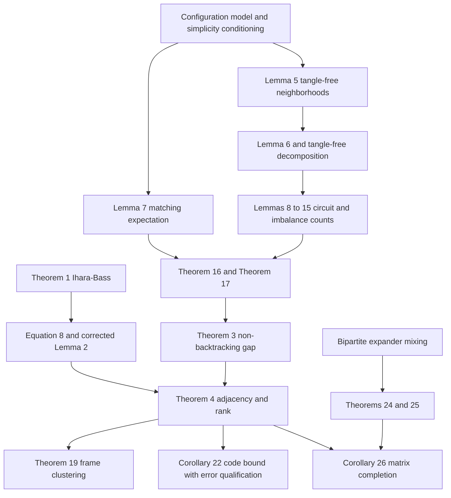

# Main results and dependency map

Use the global abbreviations from `03-notation.md`: $a=d_1-1$, $b=d_2-1$, $\rho=\sqrt{ab}$, and $\tau=(ab)^{1/4}$.

## 1. Spectral results

### Theorem 1: Ihara-Bass formula

**Paper, page 6:** For a finite graph,

$$\det(B-\lambda I)=(\lambda^2-1)^{|E|-|V|}\det(D-\lambda A+\lambda^2I),$$

where $D_{vv}=d_v-1$.

**Role:** Converts arbitrary adjacency spectral questions into non-backtracking determinant questions. The shifted $D$ is important. This is not the ordinary degree matrix.

**Dependencies:** Imported from Bass and later work. Its general determinant proof is not reproduced in this dossier.

**Type check:** $B$ has size $2|E|$. The determinant factor has polynomial degree $2(|E|-|V|)+2|V|=2|E|$, matching the left side.

### Lemma 2: eigenvalues generated by zero and nonzero adjacency eigenvalues

**Paper intent, pages 7 to 8:** Classify $B$ eigenvalues into four types. The preceding nullspace calculation supplies the exact imaginary roots.

**Derived corrected classification:** Let $r=\operatorname{rank}(X)$ and $N=n+m$. Then:

1. $\pm1$ each have multiplicity $|E|-N$ as counted by the determinant prefactor.
2. $\pm i\sqrt b=\pm i\sqrt{d_2-1}$ each have multiplicity $m-r$.
3. $\pm i\sqrt a=\pm i\sqrt{d_1-1}$ each have multiplicity $n-r$.
4. Each pair $\pm\xi$ of nonzero adjacency eigenvalues generates four roots through Equation 7.

**Statement audit:** Printed Lemma 2 item 2 instead says $\pm i\sqrt a$ has multiplicity $m-r$, and item 3 says $\pm i\sqrt b$ has multiplicity $r$. These conflict with page 7, where the nullities are computed correctly. They also fail the total dimension count. The corrected list gives

$$2(|E|-N)+2(m-r)+2(n-r)+4r=2|E|.$$

The full-rank argument later uses precisely the corrected $n-r$ multiplicity for $\pm i\sqrt a$.

### Theorem 3: second non-backtracking eigenvalue

**Paper, page 8:** There exists $\epsilon_n\to0$ such that, asymptotically almost surely,

$$|\lambda_2(B)|\leq \tau+\epsilon_n.$$

Equivalently, the probability of exceeding $\tau+\epsilon_n$ vanishes as $n\to\infty$.

**Formal reading:** Degrees are fixed, $nd_1=md_2$, the simple graph is uniform, and $\lambda_2$ is ordered by absolute value after the dominant pair. The theorem gives existence of a vanishing sequence, not a specified rate.

**Proof dependencies:** Configuration model, tangle-free local neighborhoods, Lemmas 6 to 15, Theorems 16 and 17, Markov's inequality, and the final $\ell$th root.

**Intuition:** The non-leading spectrum lies asymptotically inside the radius corresponding to the adjacency bulk.

### Theorem 4: adjacency gap, lower positive edge, and rank

**Paper, pages 8 to 9:** For a uniform simple biregular graph with $d_1\geq d_2$, there are vanishing sequences such that:

1. $\eta\leq\sqrt a+\sqrt b+\epsilon_n'$.
2. $\eta_{\min}^{+}\geq\sqrt a-\sqrt b-\epsilon_n''$.
3. If $a>b$, equivalently $d_1>d_2$, then $\operatorname{rank}(X)=n$ with high probability.

**Dependencies:** Theorems 1 and 3 plus the corrected Lemma 2 nullspace categories and Equation 8 case analysis.

**Intuition:** Non-backtracking outliers are easier to rule out. Once ruled out, no adjacency eigenvalue can remain outside the closed bulk, up to vanishing deformation.

**Limits:** The theorem is asymptotic. It does not give exact Ramanujan spectrum for finite graphs, does not claim an explicit singular-value lower bound at a fixed $n$, and gives no useful lower positive edge when $a=b$.

## 2. Configuration-model and local-structure inputs

### Lemma 5: logarithmic tangle-free neighborhoods

**Paper, page 11:** If $\ell<\frac18\log_d n$, then the graph is $\ell$-tangle-free with probability at least $1-n^{-1/2}$.

**Definition:** Every radius-$\ell$ ball has at most one cycle.

**Proof idea:** Reveal neighborhoods by breadth-first matchings. Two cycle-forming matches inside one small ball are already unlikely. A binomial tail bound and vertex union bound finish.

**Use:** Replace complete matrix powers by their tangle-free path restrictions in the moment estimate.

### Lemma 6: remove the dominant rank-two part

**Paper, page 12:** If $\operatorname{Im}T\subset\ker R$ and $\operatorname{Im}T^*\subset\ker R$, any eigenvalue $\lambda$ of $T+R$ not belonging to $T$ obeys

$$|\lambda|\leq\max_{x\in\ker T}\frac{\|(T+R)x\|}{\|x\|}.$$

For $B^\ell$, choose $T$ to encode eigenvalues $\pm\rho^\ell$ and vectors $\mathbf1_\alpha,\mathbf1_{-\alpha}$. Then the remaining bound is on $\|B^\ell x\|$ with both block-coordinate means zero.

**Caution:** Equation 10 should be read with modulus and an $\ell$th root, as done in Section 5.9. It is a non-normal operator, so an ordinary orthogonal spectral theorem is not available.

## 3. Matching moment and combinatorial lemmas

### Lemma 7: expected matching product

**Paper, page 15:** For $1\leq k\leq\sqrt{|E|}$ and a split $t_0$, the absolute expectation of a product of $\bar M$ factors before $t_0$ and $M$ factors afterward is bounded by

$$C2^{\mathfrak b}\left(\frac1{|E|}\right)^{\mathscr E}
\left(\frac{3k}{\sqrt{|E|}}\right)^{\mathscr E_1}.$$

Here $\mathfrak b$ counts inconsistent multiplicity-one edges before $t_0$, and $\mathscr E_1$ counts consistent multiplicity-one edges before $t_0$.

**Role:** Distinct matching edges contribute roughly $|E|^{-1}$ each. Centered singleton patterns can gain extra smallness. Inconsistent edges require the extra $2^{\mathfrak b}$ bookkeeping.

**Dependency status:** After converting the bipartite block matching to one permutation matrix, the proof invokes Bordenave's Proposition 28. That external statement has not been independently re-proved here.

### Lemma 8: minimal encoding

**Paper, page 17:** In a minimal sequence of triples $(p_i,q_i,r_i)$, a non-final triple cannot have $r_i=0$.

**Role:** Every non-final triple consumes a non-tree edge, bounding the number of triples by cycle excess plus one.

### Lemma 9: tangle-free circuit count

**Paper, page 18:** With $\chi=\mathscr E-\mathscr V+1$,

$$C_{\mathscr V,\mathscr E}^{\mathscr R}\leq
m^{\mathscr R}n^{\mathscr V-\mathscr R}(2\ell)^{4k}
((\mathscr V+1)^2(\ell+1))^{2k(\chi+1)}.$$

**Dependencies:** Three-part path encoding, one-cycle modification, ordered vertex choices, and concatenating $2k$ legs.

**Intuition:** Actual vertex choices supply $m^{\mathscr R}n^{\mathscr V-\mathscr R}$. The remaining factor is subpolynomial in $n$ at the proof's parameter choices.

### Lemma 10: remainder circuit count

**Paper, page 18:** For paths in $T^{\ell,j}$,

$$D_{\mathscr V,\mathscr E}^{\mathscr R}\leq
m^{\mathscr R}n^{\mathscr V-\mathscr R}(2\ell)^{6k}
((\mathscr V+1)^2(\ell+1))^{6k(\chi+1)}.$$

**Reason:** Each tangled path is split into three tangle-free pieces, so exponents are deliberately more generous.

### Lemma 11: half-edge label count

**Paper, page 19:** The number of half-edge choices is at most

$$d_1^{\mathscr V-\mathscr R}(d_1-1)^{\mathscr E-\mathscr V+\mathscr R}
 d_2^{\mathscr R}(d_2-1)^{\mathscr E-\mathscr R}.$$

**Proof:** A vertex of induced degree $g_v$ needs an ordered choice of distinct half-edges:

$$d_i(d_i-1)\cdots(d_i-g_v+1)\leq d_i(d_i-1)^{g_v-1}.$$

Sum degrees separately on the two sides.

### Corollary 12: packaged half-edge bound

**Printed assertion, page 19:** Replace the previous bound by

$$(d_1(d_1-1))^{\mathscr V-\mathscr R}(d_2(d_2-1))^{\mathscr R}(d-1)^{2(\chi-1)}.$$

**Audit status:** It does not follow from Lemma 11 as a general inequality. For a single left-right edge, $\mathscr V=2,\mathscr R=1,\mathscr E=1,\chi=0$. Lemma 11 gives $d_1d_2$, but Corollary 12 gives $d_1d_2(d_2-1)/(d_1-1)$ when $d_1>d_2$, which is smaller. A longer simple path gives the same issue. This corollary's application inside Equation 26 therefore needs separate repair or justification.

### Lemma 13: signed imbalance bound

**Paper, page 19:** For $\ell<\frac1{32}\log_d n$, $\psi\leq16k^2$ with high probability.

**Proof mechanism:** Add segments sequentially. If a new segment splits from an earlier one at three vertices, their union contains two cycles, contradicting local tangle-freeness.

**Caution:** The statement bounds $\psi=\mathscr R-\mathscr E/2$ from above only. Using it to absorb factors for arbitrarily large negative $\psi$ would require a matching lower bound or an independent structural argument.

### Lemmas 14 and 15: inconsistent edges

**Paper, pages 19 to 20:** For ordinary and remainder circuits respectively,

$$b_\mathcal C\leq4(k+\chi),\qquad b_\mathcal D\leq16k+4\chi.$$

These bound the $2^b$ factors in Lemma 7 by cycle excess and segment count. The second uses a decomposition into $4k$ pieces and at most $2k$ connected components in the relevant union.

## 4. Norm estimates and the finish

### Theorem 16: main centered norm bound

**Paper, page 20:** For $\ell=\lfloor c\log n\rfloor$ with $c<1/32$,

$$\|\bar B^{(\ell)}\|\leq \tau^\ell\exp((\log n)^{3/4})$$

asymptotically almost surely.

**Proof skeleton:** Set $k=\lfloor(\log n)^{1/3}\rfloor$, expand a $2k$th trace moment, and partition circuits into:

- $\mathcal C_1$: every edge traversed at least twice.
- $\mathcal C_2$: a singleton edge and $\mathscr V\leq k\ell+1$.
- $\mathcal C_3$: a singleton edge and $\mathscr V>k\ell+1$.

Their contributions $I_1,I_2,I_3$ use respectively maximal repeated-edge paths, an extra cycle-excess factor, and centering penalties for many singleton edges.

**Audit note:** Equation 34 accidentally writes $\|B^{(\ell)}\|$ in the event, while the theorem and numerator expectation concern $\|\bar B^{(\ell)}\|$.

### Theorem 17: tangled remainder norm

**Paper, page 24:** For each $1\leq j\leq\ell$,

$$\|R^{\ell,j}\|\leq\frac{(d-1)^\ell}{n}\exp((\log n)^{3/4})$$

asymptotically almost surely.

**Key source of $n^{-1}$:** Every segment has a deterministic $S$ factor bounded by $(d-1)/|E|$. Across $2k$ segments this contributes $|E|^{-2k}$, with $|E|$ proportional to $n$.

**Uniformity caution:** The final proof sums $j=1,\ldots,\ell$. It needs the proof's $j$-independent moment estimates to be applied uniformly, not a naive union of $\ell$ unquantified separate claims.

### Section 5.9: vanishing final error

The two norm bounds give, up to tangle-free replacement,

$$|\lambda_2(B)|\leq
\left[e^{(\log n)^{3/4}}\tau^\ell+
\ell e^{(\log n)^{3/4}}\frac{(d-1)^\ell}{n}\right]^{1/\ell}.$$

The second summand is polynomially small in $n$ by choosing $c<\min\{1/32,1/\log d\}$. The main factor after taking the $\ell$th root is $\tau(1+o(1))$. This yields Theorem 3.

## 5. Applications

### Proposition 18: blockwise bound on stochastic eigenvalues

**Paper attribution:** Wan and Meila, page 29.

Under nonzero frame-degree eigenvalues and a common block ratio at most $C<1$, eigenvalues of $P$ not inherited from $R$ have absolute value at most

$$C\max_k\left(R_{kk}+\sum_{\ell\ne k}\sqrt{R_{k\ell}R_{\ell k}}\right).$$

For a biregular block, Theorem 4 gives asymptotic ratio

$$\frac{\sqrt{D_{kl}-1}+\sqrt{D_{lk}-1}}{\sqrt{D_{kl}D_{lk}}}+\epsilon.$$

**Audit note:** The printed symmetric block matrix has inconsistent lower-block transposes in one displayed form. Its intended lower-left block must have the transposed dimensions and be $L^{(lk)}=(L^{(kl)})^*$.

### Theorem 19: spectral clustering for frame graphs

**Paper, page 30:** If the $K$ frame Markov eigenvalues are nonzero, all frame degrees can be multiplied by one sufficiently large integer $\kappa$ so that the leading $K$ eigenvectors of $P$ recover the classes.

**Reason:** Common scaling leaves $R$ and its class eigenvectors fixed but makes the stochastic block remainder arbitrarily small. Class-wise constant frame eigenvectors lift explicitly.

**Scope:** This does not assert a sharp threshold, and it relies on large enough degrees.

### Theorem 20: cited sharp regular-SBM result

For within-degree $d_1$ and between-degree $d_2$ with $d_1>d_2$, the cited strong-recovery condition is

$$(d_1-d_2)^2>4(d_1+d_2-1).$$

This is a cited comparison theorem, not a theorem proved by the present paper's core argument.

### Theorem 21 and Corollary 22: code distance

**Paper attribution:** Janwa-Lal, page 31. If $\delta_1\geq\delta_2>\eta/2$, the Tanner code has minimum distance

$$\delta\geq\frac n{d_2}\left(\delta_1\delta_2-\frac\eta2(\delta_1+\delta_2)\right).$$

**Claimed specialization, Corollary 22:** Replace $\eta$ with $\sqrt a+\sqrt b$ and subtract $\epsilon_n$ inside the bracket.

**Audit qualification:** Theorem 4 supplies $\eta\leq\sqrt a+\sqrt b+\tilde\epsilon_n$. Deterministic substitution gives

$$\delta\geq\frac n{d_2}\left[\delta_1\delta_2-
\frac{\sqrt a+\sqrt b}{2}(\delta_1+\delta_2)-
\frac{\tilde\epsilon_n}{2}(\delta_1+\delta_2)\right].$$

The final error in that formula is multiplied by $n/d_2$. An unscaled $\epsilon_n\to0$ inside the bracket does not directly follow. Corollary 22 and its numerical finite-size example require an explicit error-rate interpretation or a new vanishing-error proof.

### Theorem 23: cited square matrix-completion bound

For a $d$-regular observation graph, the cited result is

$$\frac1{n^2}\|\hat Y-Y\|_F^2\leq8K_G\gamma_2(Y)^2\frac\eta d.$$

This motivates the rectangular improvement proved next.

### Theorem 24: rectangular matrix-completion bound

**Paper, pages 33 to 34:** For a biregular observation graph and minimizer of $\gamma_2$ subject to exact sampled-entry agreement,

$$\frac1{nm}\|\hat Y-Y\|_F^2\leq4K_G\gamma_2(Y)^2\frac\eta{\sqrt{d_1d_2}},$$

with $4K_G\leq7.13$.

**Proof inputs:** Bipartite expander mixing, sign nuclear norm, Grothendieck's inequality, Hadamard submultiplicativity of $\gamma_2$, and $\gamma_2(\hat Y)\leq\gamma_2(Y)$ from optimality.

### Theorem 25: noisy completion

If $Z=Y+\epsilon$ has sampled mean-square noise at most $\delta^2$, minimizing $\gamma_2$ subject to sampled error at most $\delta^2$ yields

$$\frac1{nm}\|\hat Y-Y\|_F^2\leq
4K_G\gamma_2(Y)^2\frac\eta{\sqrt{d_1d_2}}+4\delta^2.$$

The proof adds the deterministic mixing discrepancy to observed squared error at most $4\delta^2$.

### Corollary 26: random-biregular sampling

**Paper, page 36:** On the high-probability spectral-gap event,

$$\frac1{nm}\|\hat Y-Y\|_F^2\leq
4K_G\gamma_2(Y)^2\frac{\sqrt a+\sqrt b+\epsilon_n}{\sqrt{d_1d_2}}.$$

The deterministic guarantee applies uniformly to every real $Y$ once the observation graph satisfies the spectral bound.

## Dependency graph

