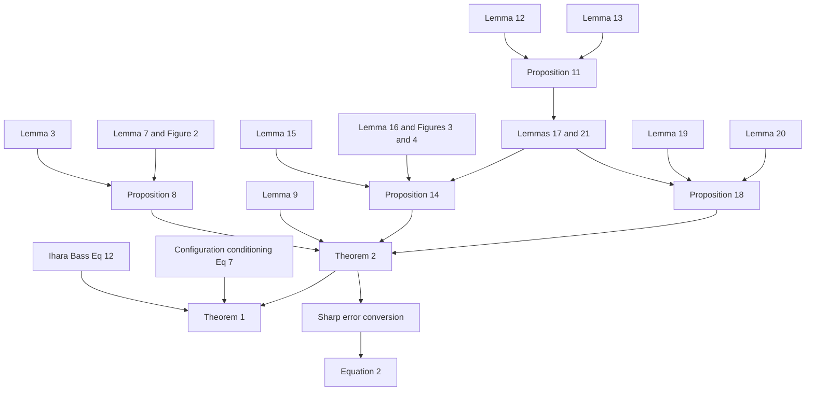
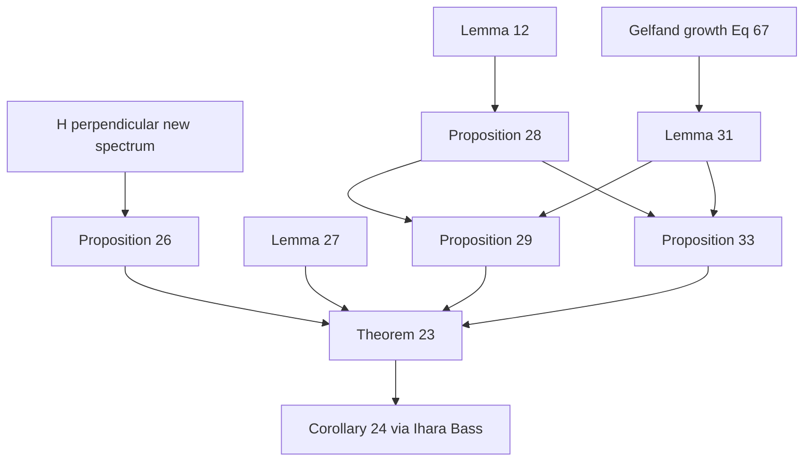

# Main results and dependencies

Statements in the next section are **Paper**. Explanations and reorganized proof logic are **Derived** or **Interpretation**, as marked.

## Principal statements

### Theorem 1: Friedman's second eigenvalue theorem

**Paper, page 2.** Let $d\geq3$, let $nd$ be even, and let $G$ be uniform among simple $d$-regular graphs on $[n]$. For every $\varepsilon>0$,

$$
\lim_{n\to\infty}\mathbb P\left(\mu_2\vee|\mu_n|
\geq2\sqrt{d-1}+\varepsilon\right)=0,
$$

along admissible $n$.

**Quantitative Paper statement, Eq. 2 on page 2.** For every $0<a<1$, some $c=c(d,a)$ gives

$$
\mathbb P\left(\mu_2\vee|\mu_n|\geq2\sqrt{d-1}
+c\left(\frac{\log\log n}{\log n}\right)^2\right)\leq n^{-a}.
$$

**Proof dependencies:** Theorem 2, configuration conditioning, and the sharp Ihara-Bass conversion.

**Intuitive meaning:** Almost every random regular graph is asymptotically as expanding as the Alon-Boppana barrier permits, up to a vanishing additive error.

### Theorem 2: non-backtracking form for the configuration model

**Paper, page 6.** Let $\sigma$ be a uniform perfect matching of $[n]\times[d]$, and let $\lambda_2$ be the second-largest eigenvalue modulus of its non-backtracking matrix $B$. For every $\varepsilon>0$,

$$
\lim_{n\to\infty}\mathbb P\left(|\lambda_2|
\geq\sqrt{d-1}+\varepsilon\right)=0.
$$

**Quantitative Paper statement, Eq. 13 on page 7.** For every $0<a<1$, some $c=c(d,a)$ gives

$$
\mathbb P\left(|\lambda_2|\geq\sqrt{d-1}
+c\frac{\log\log n}{\log n}\right)\leq n^{-a}.
$$

**Proof dependencies:** Proposition 8's deterministic decomposition, Lemma 9's tangle estimate, and Propositions 14 and 18's norm estimates.

**Role:** This is the actual random-matrix statement proved by the main technical work.

### Proposition 8: deterministic norm reduction after deleting tangles

**Paper, page 11.** If $G(\sigma)$ is $\ell$-tangle-free, then

$$
|\lambda_2|\leq\left(\|\underline B^{(\ell)}\|
+\frac1{dn}\sum_{k=1}^{\ell}\|R_k^{(\ell)}\|\right)^{1/\ell}.
$$

**Proof dependencies:** Lemma 3, tangle-free path restriction, and the telescoping decomposition Lemma 7.

**Intuitive meaning:** Two objects need control, not an unmodified power of $B$: the centered tangle-free block and the cost of paths whose separately tangle-free pieces form a tangle when joined.

### Lemma 9: local tangle-freeness

**Paper, pages 11 and 12.** A uniform configuration graph is $\ell$-tangle-free with probability at least

$$
1-O\left(\frac{(d-1)^{4\ell}}n\right).
$$

**Proof dependencies:** Sequential neighborhood exploration. Two closure collisions are needed for two cycles in a local neighborhood, and $T=O((d-1)^\ell)$ explored edges suffice.

**Role:** It certifies that Proposition 8 applies on a typical graph at the logarithmic radius used in the last step.

### Proposition 11: mixed product expectation

**Paper, page 13.** For $k\leq\sqrt{dn}$ and $0\leq k_0\leq k$,

$$
\left|\mathbb E\prod_{t=1}^{k_0}\underline M_{\gamma_{2t-1}\gamma_{2t}}
\prod_{t=k_0+1}^{k}M_{\gamma_{2t-1}\gamma_{2t}}\right|
\leq c\,2^b\left(\frac1{dn}\right)^a
\left(\frac{3k}{\sqrt{dn}}\right)^{a_1}.
$$

Here $a$ is the number of distinct visited half-edge pairs, $b$ counts centered occurrences on inconsistent pairs of multiplicity one, and $a_1$ counts centered occurrences on consistent pairs of multiplicity one.

**Proof dependencies:** Conditional matching exposure, Lemma 12's moment estimate, and Lemma 13's factor-by-factor bound.

**Intuitive meaning:** Each distinct required matching pair costs roughly $(dn)^{-1}$. Consistent pairs occurring exactly once in a centered segment receive an additional small factor from cancellation, instead of behaving like independent uncentered indicators.

### Lemma 12: binomial alternating-product bound

**Paper, pages 13 through 15.** If $N\sim\operatorname{Bin}(k,p)$, $z\geq1$, $0<p,q<1$, and

$$
4\left(1-\frac{p}{q(1-p)}\right)^2\leq zqk^2\leq1,
$$

then

$$
\left|\mathbb E\prod_{j=0}^{N-1}\left(zj-\frac1q\right)\right|
\leq4\left(3k\sqrt{\frac{zq}{2}}\right)^k.
$$

**Proof dependencies:** Expansion into polynomial functions $P_s(t)$ of degree $2s$ and exact cancellation of degree-at-most-$k-1$ terms under the signed binomial sum.

**Role:** This is the analytic engine inside the near-centering part of Proposition 11.

### Proposition 14: centered norm

**Paper, page 19.** Uniformly for the stated regime $1\leq\ell\leq\log n$, with high probability,

$$
\|\underline B^{(\ell)}\|\leq(\log n)^{15}(d-1)^{\ell/2}.
$$

**Proof dependencies:** High trace, Proposition 11, and Lemmas 15 through 17 controlling labelings, canonical path circuits, and expected weights. The moment choice is $m=\lfloor\log n/(13\log\log n)\rfloor$.

**Interpretation:** This is the `$2^m$ trace moments produce a square-root' step. The centered non-backtracking operator is controlled at $\sqrt{d-1}$ per step, not $d-1$ per step.

### Proposition 18: total remainder norm

**Paper, page 25.** With high probability,

$$
\sum_{k=1}^{\ell}\|R_k^{(\ell)}\|
\leq(\log n)^{30}(d-1)^\ell.
$$

**Proof dependencies:** Modified supports with a removed matched pair on each strand, cyclic-component enumeration, expectation bounds, and $m=\lfloor\log n/(25\log\log n)\rfloor$.

**Interpretation:** The remainder is allowed a much larger scale than the centered term because Proposition 8 multiplies it by $1/(dn)$. At the final $\ell$, $n^{-1}(d-1)^\ell$ is polynomially small.

### Theorem 23: new non-backtracking spectrum of random lifts

**Paper, page 32.** Let $G$ be finite and connected with $|E|>|V|$, and let $G_n$ be a random $n$-lift. Let $\rho_1$ be the Perron eigenvalue of the base non-backtracking matrix. If $\lambda_1$ is the largest new non-backtracking eigenvalue of $G_n$, then for every $\varepsilon>0$,

$$
\lim_{n\to\infty}\mathbb P\left(|\lambda_1|
\geq\sqrt{\rho_1}+\varepsilon\right)=0.
$$

**Proof dependencies:** Proposition 26 on $H^\perp$, Lemma 27, Proposition 28, Propositions 29 and 33, and the base-path growth bound behind Lemma 31.

**Intuitive meaning:** After deleting all inherited base behavior, the lift's non-backtracking spectrum is bounded asymptotically by the non-backtracking growth scale of the universal cover.

### Corollary 24: new adjacency spectrum for a regular base

**Paper, page 32.** If the base is $d$-regular and $\mu_1$ is the largest new adjacency eigenvalue of a random $n$-lift in absolute value, then for every $\varepsilon>0$,

$$
\lim_{n\to\infty}\mathbb P\left(|\mu_1|
\geq2\sqrt{d-1}+\varepsilon\right)=0.
$$

**Proof dependencies:** Theorem 23 and Ihara-Bass.

**Scope:** This does not settle the irregular-base adjacency conjecture stated on page 32.

## Central lift estimates

### Proposition 26: deterministic lift reduction

**Paper, page 35.** On an $\ell$-tangle-free lift,

$$
|\lambda_1|\leq\left(\|\underline B_n^{(\ell)}\|
+\frac1n\sum_{k=1}^{\ell}\|R_k^{(\ell)}\|\right)^{1/\ell}.
$$

The only new eigenvalue appears because the estimate is restricted to $H^\perp$.

### Proposition 28: permutation product expectation

**Paper, page 36.** For a path product on a lift, with $k\leq\sqrt n$,

$$
|\mathbb E P|\leq c\,2^b n^{-a}
\left(\frac{3k}{\sqrt n}\right)^{a_1}.
$$

This is the random-permutation counterpart of Proposition 11. Independence across undirected base edges reduces its proof to one permutation.

### Lemma 31: canonical lift path growth

**Paper, pages 41 and 42.** For fixed $\rho>\rho_1$, there is a constant $c=c(\rho,G)$ such that the number of canonical path circuits with $s$ vertices, $a$ distinct pairs, and $g=a-s+1$ is at most

$$
\rho^s(c\ell m)^{8mg+10m}.
$$

**Proof dependencies:** The first-exit decomposition, tangle-free cycle compression, finite base choice, and

$$
\prod_{i,q}\|(B^*)^{s_q^i}\delta_{e_q^i}\|_1
\leq c_\rho^{2m(g+1)}\rho^{s-1},
$$

which follows from Eq. 67 and $\sum_{i,q}s_q^i=s-1$.

**Role:** This is where $\rho$, rather than the regular branching factor $d-1$, enters the trace count.

### Propositions 29 and 33: centered and remainder lift norms

**Paper, pages 40 and 44.** With high probability, for fixed $\rho>\rho_1$,

$$
\|\underline B_n^{(\ell)}\|\leq(\log n)^{20}\rho^{\ell/2},
$$

and

$$
\sum_{k=1}^{\ell}\|R_k^{(\ell)}\|\leq(\log n)^{40}\rho^\ell.
$$

**Role:** After division of the remainder by $n$ and taking the $\ell$-th root, choosing $\rho$ close to $\rho_1$ gives Theorem 23.

## Dependency graphs

### Configuration model and regular graphs

### Random lifts

## Derived hierarchy to remember

1. Proposition 11 is the **single-path probabilistic estimate**.
2. Lemmas 15 through 17 turn it into the **whole-circuit estimate**.
3. Proposition 14 turns circuit estimates into a **centered norm estimate**.
4. Proposition 18 supplies the **remainder norm estimate**.
5. Proposition 8 combines them with tangle-freeness to prove Theorem 2.
6. Ihara-Bass and configuration conditioning produce Theorem 1.
7. The lift proof repeats this hierarchy, with base non-backtracking growth controlling canonical path classes.

**Interpretation:** The sharp theorem comes from the interplay of a $\sqrt{d-1}$ centered scale and a $1/n$ remainder discount. Memorizing only the final norm bounds hides the reason the argument works.
