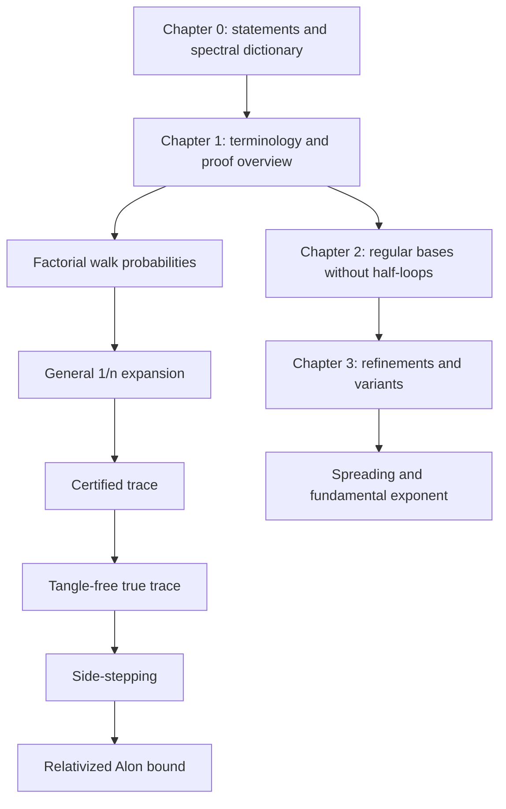

# Paper structure and visual inventory

**Label convention.** Section purposes and theorem locations are **Paper**. Reading priorities, dependency summaries, and visual interpretations are **Derived** or **Interpretation**. Page numbers are printed paper pages. Add 7 for the PDF page number.

## Global architecture

## Front matter, PDF pages 1 to 7

| Component | Purpose | Read carefully or skim | Visual reading |
| --- | --- | --- | --- |
| Title page | Identifies authors and arXiv version | Skim after recording provenance | No graphic |
| Contents, pages v to vii | Gives the four-chapter hierarchy and technical subsections | Use for navigation, not proof logic | Hierarchical text only |
| Abstract, page viii | States the $O(n^{-1})$ theorem and Ramanujan refinement | Read before Chapter 0 | Text only |
| List of Symbols, pages ix to x | Maps symbols to first-use pages | Essential as a reference because $\rho$, $\mu$, $k$, $r$, and $\epsilon$ change roles | Two-column symbol-definition-page table with dot leaders. Red boxes are reference links, not categories |

**Visual conclusion, Derived.** There are no substantive images in the front matter. The List of Symbols is best used as a two-axis lookup: symbol family on the left, definition and first page on the right. It groups the spectral symbols first, then walk and type symbols. That ordering mirrors the proof path from goal to machinery.

## Chapter 0: Introduction, printed pages 1 to 10

| Section | Purpose and key claims | Dependencies and reading instruction | Visual inventory |
| --- | --- | --- | --- |
| Opening, pages 1 to 2 | Motivates relative expanders and describes Chapter 2 as the regular no-half-loop proof | Requires only adjacency basics. Read for scope | No figures. No plotted spectra |
| 0.1 Main Results, page 3 to 4 | Defines $\operatorname{Spec}_B^{\mathrm{new}}(A_G)$ and $\rho_B^{\mathrm{new}}$. States Theorems 0.1.1 and 0.1.3 | Read exactly. The Broder-Shamir model is only fully defined later | Equations (0.1) to (0.5) collect the main claims. Equation (0.2)'s trace subtraction contains no factor $n$ |
| 0.2.1 Original Alon conjecture, pages 4 to 6 | Recalls earlier bounds and model-dependence of exponents | Can skim history after understanding the main statement | Text and display bounds only |
| 0.2.2 Relativized conjecture, pages 6 to 9 | Universal-cover threshold $\rho(A_{\widehat B})$, category motivation, and old-new reasoning | Read the exact threshold and the bouquet special cases | No category diagram. The categorical explanation is entirely verbal |
| 0.2.3 Hashimoto matrix, pages 9 to 10 | Ihara-Bass formula, quadratic $\mu^2-\lambda\mu+(d-1)=0$, and general Theorems 0.2.6 and 0.2.7 | Essential conversion from trace machinery to adjacency conclusion | Equation (0.9) is the central spectral display, not a plot of roots |

## Chapter 1: Terminology and overview, printed pages 11 to 35

| Section | Purpose and key definitions | Dependencies and reading instruction | Visual inventory |
| --- | --- | --- | --- |
| 1.1.1 to 1.1.2, pages 11 to 13 | Graph involution, walks, non-backtracking walks, adjacency, directed line graph, Hashimoto matrix | Prerequisite indexing must be exact | No graph drawings. Directed-line adjacency is given by a set-builder display |
| 1.1.3, pages 14 to 17 | Covering and étale maps, permutation assignments, old and new functions | Propositions 1.1.12 and 1.1.15 connect embeddings to partial permutations | No fibre-bundle illustration. Equation (0.2) is repeated in Hashimoto form |
| 1.1.4 to 1.1.5, pages 17 to 19 | Variable-length graphs, monotonicity, continuity, $\mathcal C_n(B)$ | Monotonicity later makes certificates an upper set. The half-loop model needs involutions | No visual depiction of path subdivision |
| 1.2.1 to 1.2.3, pages 19 to 22 | Single-moment bounds, asymptotic expansions, advantage of Hashimoto traces | Read for why $k$ later scales logarithmically | Equations (1.2) to (1.12) show changing spectral thresholds, not data plots |
| 1.2.4, pages 23 to 24 | Tangles, order, feasible subgraphs, obstruction to raw trace methods | Central motivation for certification | Tangles are defined algebraically. No tangle picture is supplied |
| 1.3.1 to 1.3.3, pages 24 to 27 | Loop count, coincidence argument, and full expected Hashimoto trace estimate | Factorial and coincidence logic is the base case of all expansions | Theorem 1.3.3 and Lemma 1.3.5 displays expose error exponents |
| 1.3.4 to 1.3.5, pages 27 to 31 | $B$-Ramanujan functions, general $1/n$ expansions, finite types | Definition 1.3.6 must be read with its for-every-$\epsilon$ error clause | Figure 8, barbell, and theta are text labels only. There are no source figures to interpret |
| 1.4, pages 31 to 33 | Certified trace and finitely generated upper sets | Conceptual center. Connect the strict spectral inequality to monotonic path lengthening | Equation (1.24)'s set $S(T)$ is the first visual signature of the certificate set |
| 1.5, pages 33 to 35 | Side-stepping, tangle indicators, weaker $B$-Ramanujan error notion | Read the subtraction logic before Chapter 2 | Equation (1.29) highlights the tangle-free expectation. There is no flowchart |

## Chapter 2: Regular case without half-loops, printed pages 37 to 104

| Section | Purpose and key claims | Dependencies and reading instruction | Visual inventory |
| --- | --- | --- | --- |
| 2.1, pages 37 to 41 | States Theorems 2.1.1 to 2.1.3 and previews type-form sums | Read before technical details. These three theorems are the bridge from certificates to the main theorem | Equations (2.1) to (2.8) are a proof map in formula form |
| 2.2.1, pages 41 to 43 | Order, pruned graphs, monotonicity under inclusion | Needed for tangle occurrence lower bounds and derived unions | Degree-sum display (2.9). No pruning diagram |
| 2.2.2 to 2.2.4, pages 43 to 50 | Polyexponential and weighted convolutions, coefficient norms, growth estimates | Technical but reusable. Check Example 2.2.13 against the defining sum, since its odd-$k$ printed formula is inconsistent | Long display derivations replace diagrams. The $(1,2)$ convolution has an exact residue-class structure |
| 2.2.5, pages 50 to 51 | Matrix walk statistics and weighted non-backtracking counts | Explains why form sums have bases in $\operatorname{Spec}(H_B)$ | Jordan form is not visualized |
| 2.3.1, pages 52 to 53 | Potential walks, trajectories, feasibility, order | Prerequisite to the main probability formula | No trajectory illustration |
| 2.3.2, page 54 to 55 | Walk collections and exact $\mathcal E_{\mathrm{symm}}$ formula | Proposition 2.3.8 is essential. Its left side counts symmetry-equivalent trajectories | Equation (2.21) is the paper's central arithmetic visual. Two factorial factors carry opposite effects on the $n$ exponent |
| 2.3.3, pages 56 to 58 | Expansion polynomials, truncation, Theorem 2.3.13 | Read derivation of $n^\chi$ carefully | Equations (2.22) to (2.27) form the general asymptotic template |
| 2.3.4, pages 58 to 63 | Types, forms, multiplicity determination, decoupling, type-form expansion | Understand what the skeleton forgets and what lettering remembers | Equation (2.33) factors a type sum into edge-local sums. No type graph is drawn |
| 2.4.1 to 2.4.2, pages 63 to 68 | Finite minimal tangles, subgraph occurrences, fundamental order | Theorem 2.4.7 supplies event exponents. Prunedness prevents double counting from contaminating the first order | Equations (2.35) to (2.37) show occurrence asymptotics. Some random-graph arguments print $B$ where $G$ is intended |
| 2.4.3, pages 68 to 73 | Finitely certifiable posets and Möbius cone sums | Prove $\mathbb Z_{\ge0}^s$ has the required property | No Hasse diagram. Cones and intersections are displayed algebraically |
| 2.4.4, page 73 to 74 | Formal certified walk collection and upper-set certificates | Strict radius inequality is crucial. Follow the displayed $\mathrm{VLG}$ monotonicity | PDF page 80, printed 73, inspected at full resolution. The upper-set formula and monotonicity display jointly explain certification |
| 2.4.5, pages 74 to 78 | Certified terms are $B$-Ramanujan | Core computational estimate. Split multiplicities and lengths before checking growth | Equation (2.39) is the cone-term template. $K_1,K_2$ displays separate short and long weighted lengths |
| 2.5.1, pages 79 to 81 | Potential graph specializations and derived graph collections | Extends factorial specialization to unions of a walk and fixed tangle | Equation (2.44) repeats the factorial structure with union counts |
| 2.5.2 to 2.5.4, pages 85 to 88 | Prove expansions with fixed tangles and conclude Theorems 2.1.1 to 2.1.3 | The generalized $\Omega$-type checklist can be skimmed after its purpose is clear | No new visual type diagram. Checklists carry the structural argument |
| 2.6.1 to 2.6.2, pages 89 to 92 | Shift algebra and improved side-stepping statement | Essential for understanding how unknown coefficients are neutralized | Equation (2.57), inspected on PDF page 98, printed 91, is the abstract partial-trace display |
| 2.6.3, pages 93 to 96 | Outlier bound with $Q(S)=\prod_{\ell\in L}(S-\ell)^D$ | Follow the three remaining exponential scales and choose $k\asymp\log n$ | Equations (2.67) to (2.73) visualize the balance of error terms, not numerical curves |
| 2.6.4 to 2.6.5, pages 96 to 101 | Isolate one base $\ell$ and obtain probability $O(n^{-j})$ | Read why the first nonzero coefficient becomes constant | $Q_{\ell,D}$ displays isolate a vertical spectral location algebraically |
| 2.7, pages 102 to 104 | Subtract old eigenvalues, apply $j=1$, convert to adjacency spectrum | Read with editorial cautions. Dropped $\operatorname{Tr}$ and $\tau$ powers must be repaired from Theorem 0.2.6 and Definition 2.6.4 | Equations (2.96) to (2.100) are inspected on PDF pages 109 and 110. The printed parameter list has a genuine power inconsistency |

## Chapter 3: Generalizations, printed pages 105 to 127

| Section | Purpose and key claims | Dependencies and reading instruction | Visual inventory |
| --- | --- | --- | --- |
| 3.1, page 105 | Irregular-base consequence using Kotani-Sunada | The threshold $2\sqrt{d_{\max}-1}$ can be weak or trivial | No example graph drawing |
| 3.2.1 to 3.2.3, pages 106 to 111 | Spreaders, spectral gap, random bouquet spreading | Separates dominant-eigenvalue issues from certified trace arguments | Factorial and entropy displays. No expansion plot |
| 3.2.4 to 3.2.5, pages 111 to 116 | Non-bipartite and bipartite spreading over general regular bases | Contract a spanning tree and apply bouquet estimates. Parity changes the proof | No spanning-tree or contraction drawing |
| 3.3, pages 117 to 120 | Fundamental exponent, two-sided tangle probability, finite algorithm, lower-bound attempt | Read full-versus-new spectrum cautions and the bouquet counterexample before accepting ancillary statements | PDF page 124, printed 117, shows full $\rho(H_G)$ in Theorem 3.3.2. PDF page 127, printed 120, shows the contraction argument |
| 3.4, pages 120 to 123 | Algebraic models and half-loop restatements | Shows why the proof depends on factorial-like expansion rather than one exact distribution | No model hierarchy diagram |
| 3.5, pages 123 to 126 | Mod-$S$ polyexponentials and strongly Ramanujan bases | Refines parity behavior in weighted convolutions | Case displays on even and odd $k$. Check the second odd formula against Example 2.2.13 |
| 3.6, pages 126 to 127 | Weighted Hashimoto matrices and direct adjacency traces as future work | Clearly speculative rather than additional theorems | Text only |

## Back matter, printed pages 129 to 137

| Component | Purpose | Visual reading |
| --- | --- | --- |
| Glossary, pages 129 to 133, PDF 136 to 140 | Gives short definitions and occurrence pages with italics marking primary definitions | Inspected PDF page 136 at full resolution. Indented subentries group related ideas such as $B$-Ramanujan functions and their error terms. Red boxes are backlinks |
| Bibliography, pages 135 to 137, PDF 142 to 144 | Records external inputs and historical context | Inspected PDF page 143. Cyan URL outlines are link styling, not content highlights |

## Complete visual inventory, explicit negative result

**Paper plus direct inspection.** No numbered figure or table environments appear in the source. No raster images are embedded in the PDF. All 144 rendered pages were scanned. There are therefore no uninspected plots, diagrams, charts, or mathematical illustrations. The only substantive structured layouts are navigation tables, display equations, and citation/backlink styling. The dossier does not manufacture figure analyses for visuals that are absent.
