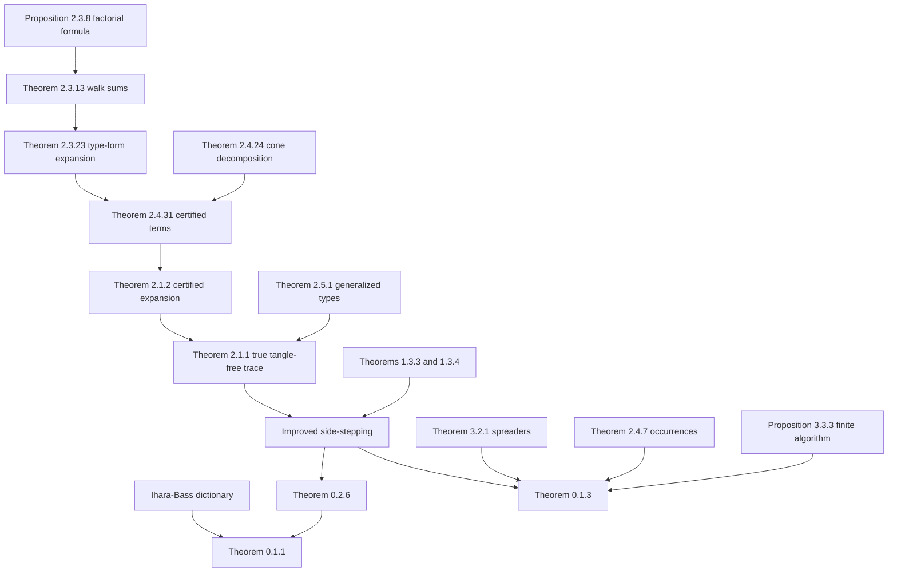

# Main results and dependencies

**Label convention.** Statements marked **Paper** are sourced at the indicated location. Statements marked **Derived** are independent explanations, calculations, or corrections. Statements marked **Interpretation** describe conceptual significance. Where the printed statement is defective, it is labeled explicitly rather than silently repaired.

## 1. Relativized Alon theorem

### Theorem 0.1.1, printed page 3, equation (0.3)

**Paper.** Let $B$ be $d$-regular with $d\ge3$. For every $\varepsilon>0$ there is $C_{B,\varepsilon}>0$ such that

$$
\Pr_{G\in\mathcal C_n(B)}\!\left[
\rho_B^{\mathrm{new}}(A_G)\ge 2\sqrt{d-1}+\varepsilon
\right]\le C_{B,\varepsilon}n^{-1}.
$$

**Formal assumptions.** The probability model is the Broder-Shamir model $\mathcal C_n(B)$ or an algebraic variant covered by Section 3.4. The base and $\varepsilon$ are fixed as the cover degree $n$ grows.

**Proof dependencies.**

- Theorem 0.2.6 for new Hashimoto eigenvalues
- Ihara-Bass equation (0.9), giving $\mu^2-\lambda\mu+(d-1)=0$
- Theorem 2.1.1 for the tangle-free true trace
- Improved Side-Stepping Lemma 2.6.7 with $j=1$
- Section 3.4 for half-loops and algebraic models

**Interpretation.** New spectra behave asymptotically like those of the universal $d$-regular tree, up to an $\varepsilon$ loss and with a polynomially small exceptional event.

**Derived.** The $O(n^{-1})$ bound is stronger than the statement that the failure probability tends to zero. It does not imply that the failure probability is asymptotic to a particular constant times $n^{-1}$ for every regular base.

## 2. Fine exponent for Ramanujan bases

### Theorem 0.1.3, printed page 4, equations (0.4) and (0.5)

**Paper.** Let $B$ be a $d$-regular Ramanujan graph with $d\ge3$. There are a finite algorithm for an integer $\eta_{\mathrm{fund}}(B)$ and an $\varepsilon_0(B)>0$ such that:

1. For some $C_1(B)>0$,

$$
\Pr\!\left[\rho_B^{\mathrm{new}}(A_G)
\ge 2\sqrt{d-1}+\varepsilon_0\right]
\ge C_1(B)n^{-\eta_{\mathrm{fund}}(B)}.
$$

2. For every $0<\varepsilon<\varepsilon_0(B)$ there is $C_2(B,\varepsilon)>0$ such that

$$
\Pr\!\left[\rho_B^{\mathrm{new}}(A_G)
\ge 2\sqrt{d-1}+\varepsilon\right]
\le C_2(B,\varepsilon)n^{-\eta_{\mathrm{fund}}(B)}.
$$

**Formal assumptions.** Ramanujan means every adjacency eigenvalue other than $d$ and the possible $-d$ has absolute value at most $2\sqrt{d-1}$.

**Proof dependencies.**

- Definition 2.4.8 of fundamental order as the minimum order of a strict tangle
- Theorem 2.4.7 for the probability of a fixed feasible tangle
- Theorem 3.2.1 to remove new eigenvalues near the dominant adjacency values
- The abstract side-stepping machinery and vanishing coefficients below the fundamental order
- Proposition 3.3.3 for finite computability

**Derived.** The theorem gives bounds of order $\Theta(n^{-\eta_{\mathrm{fund}}})$ for suitably small spectral thresholds. It does not claim $C_1=C_2$, a limiting ratio, or uniform constants in $B$ and $\varepsilon$.

**Source caution.** Proposition 3.3.1 and Theorem 3.3.2 print $\rho(H_G)$ instead of the new radius required by the argument. The upper statement is false as printed. All quotations of the two-sided result should point back to Theorem 0.1.3 and the detailed correction notes.

## 3. General Hashimoto theorem

### Theorem 0.2.6, printed page 10

**Paper.** Let $B$ be connected with negative Euler characteristic. Suppose $\tau_0>0$ satisfies:

1. $\tau_0^2\ge\rho(H_B)$.
2. For every relevant cover $G$ in the model, all non-real eigenvalues of $H_G$ have modulus at most $\tau_0$.

Then for every $\varepsilon>0$ there is $C_\varepsilon$ for which

$$
\Pr_{G\in\mathcal C_n(B)}\!\left[
\rho_B^{\mathrm{new}}(H_G)\ge\tau_0+\varepsilon
\right]\le C_\varepsilon n^{-1}.
$$

**Formal assumptions.** A finite connected base of negative Euler characteristic and a random-cover model satisfying the paper's algebraic expansion requirements. Chapter 2 initially excludes half-loops.

**Proof dependencies.** Theorem 2.1.1, the loop calculation of Theorem 1.3.4, and Lemma 2.6.7.

**Derived role.** This is the theorem that actually comes out of the Hashimoto trace method. The adjacency theorem is a regular-case spectral translation, not a direct estimate of backtracking adjacency walks.

**Source caution, Section 2.7.** When choosing an abstract partial trace, the printed parameter $\tau_1=(\tau_0)^{1/2}$ can violate $\tau_0<\tau_1$. The final sentence also changes $\tau_0+\varepsilon$ to $\tau_0^{1/2}+\varepsilon$. The coherent reading uses an outer bound such as $\rho(H_B)$ for $\tau_1$ and keeps the theorem's threshold $\tau_0+\varepsilon$.

## 4. Limited irregular-base consequence

### Theorem 0.2.7 and Section 3.1

**Paper.** Conjecture 0.2.5 holds with $\rho(A_{\widehat B})$ replaced by $2\sqrt{d_{\max}-1}$.

**Proof dependencies.** Theorem 0.2.6 plus Kotani-Sunada's result that non-real Hashimoto eigenvalues have modulus at most $\sqrt{d_{\max}-1}$. The authors also use $\rho(H_B)\le d_{\max}-1$ from directed-line degrees.

**Interpretation.** This is intentionally weaker than the optimal universal-cover threshold. For some irregular graphs it can be weaker than a trivial bound from $\rho(A_B)$.

## 5. Expected trace expansion

### Theorems 1.3.3 and 1.3.4, printed page 25

**Paper.** For a connected base of negative Euler characteristic, the expected number of length-$k$ loops and the expected full Hashimoto trace agree with leading base-trace terms plus controlled errors for sufficiently small $k^2/n$. If $m$ is the least divisor of $k$ greater than $1$, the loop theorem distinguishes the primitive length-$k$ term from shorter divisors through $\operatorname{Tr}(H_B^{k/m})$.

**Proof dependencies.** Exact lift-count bounds and the order/coincidence estimate in Lemma 1.3.5. The full trace estimate adds the expected number of non-loop walks of order at least one.

**Derived role.** The leading term identifies $\operatorname{Tr}(H_B^k)$ as the $n^0$ coefficient. After subtracting the old trace, the leading polyexponential principle part vanishes, allowing side-stepping with $j=1$.

### Definition 1.3.7 and Theorem 2.3.13

**Paper.** An order-$r$ expansion has the form

$$
f(k,n)=P_0(k)+P_1(k)n^{-1}+\cdots+P_{r-1}(k)n^{1-r}
+\operatorname{err}(k,n),
$$

with, in the usual error-bound version,

$$
|\operatorname{err}(k,n)|
\le Ck^{2r+2}\rho(H_B)^k n^{-r}
$$

on an appropriate range of $k$ relative to $n$. Theorem 2.3.13 proves this expansion for general walk sums whose coefficients are grouped by potential-walk order.

**Derived role.** Existence of an expansion is not enough. The critical additional requirement is that each $P_i$ be $B$-Ramanujan, which raw high-order trace coefficients can fail to satisfy.

### Proposition 2.3.8, printed page 55, equation (2.21)

**Paper.** With no half-loops,

$$
\mathcal E_{\mathrm{symm}}(w,\mathbf t)_n
=\prod_{v\in V_B}\frac{n!}{(n-b_v)!}
\prod_{e\in E_B}\frac{(n-a_e)!}{n!}.
$$

Half-loops replace the corresponding ordinary factorial ratio by an odd-factorial ratio.

**Derived role.** This single display is the origin of every $1/n$ coefficient and of the fixed-shape occurrence exponent.

## 6. Certified trace expansion and recovery of the true trace

### Theorem 2.1.2, printed page 38

**Paper.** For every positive integer $r$, $\mathbb E[\mathrm{CertTr}_{<r}(G,k)]$ has an order-$r$ expansion with the usual error bound and $B$-Ramanujan coefficients.

**Proof dependencies.**

- General walk-sum expansion, Theorem 2.3.13
- Type-form expansion, Theorem 2.3.23
- Finitely certifiable partial orders, Theorem 2.4.24
- Finite tangle certificates, Proposition 2.4.28 and Corollary 2.4.29
- Certified coefficient estimate, Theorem 2.4.31
- Convolution closure from Section 2.2

**Interpretation.** Certification is not just an arbitrary way to discard bad walks. It is chosen so that the remaining coefficient sums decompose into finitely many sums whose exponential growth can be bounded.

### Theorem 2.4.31, printed pages 74 to 75

**Paper.** Each term

$$
\operatorname{Term}[\mathcal T,\mathbf k_0,r](k)
=\sum_{\mathbf k\ge\mathbf k_0}
\sum_{\mathbf m\cdot\mathbf k=k}
W_{\mathcal T}(\mathbf m,\mathbf k)P_i(\mathbf k)
$$

is $B$-Ramanujan. Theorem 2.1.2 follows by finite linear combination.

**Derived proof mechanism.** Split edge multiplicities into short $m_f\le M$ and long $m_f\ge M+1$ classes. Long-only classes have $\sum_f k_f\le k/(M+1)$, which suppresses the polyexponential factor. Short-edge cases split the total weighted length into $K_1+K_2=k$ and become finite weighted convolutions of a polyexponential part with a subcritical-growth part.

### Theorem 2.1.3 and Theorem 2.1.1, printed pages 37 to 38

**Paper.** The expected certified trace with the tangle indicator has an order-$r$ $B$-Ramanujan expansion. Subtracting it from the total certified trace gives the tangle-free certified trace. Finally,

$$
\mathbb E\!\left[\mathbb I_{\mathrm{TF}(r,B)}(G)
\operatorname{Tr}(H_G^k)\right]
$$

has an order-$r$ expansion with the usual error and $B$-Ramanujan coefficients.

**Proof dependencies.** Theorem 2.5.1 for generalized $\Omega$-types, finite minimal tangles, and the fact that certified and order-truncated SNBC walks agree on tangle-free graphs.

**Derived distinction.** This is not an expansion for the expectation conditioned on tangle-freeness. Multiplying by the indicator is essential.

## 7. Subgraph occurrence and tangle probability

### Theorem 2.4.7, printed pages 65 to 66

**Paper.** For a fixed étale $B$-graph $\phi:\psi\to B$ of order $s\ge1$, the expected number of occurrences has leading form $n^{-s}+O(n^{-s-1})$. Under prunedness and positive order of each component, the probability of at least one occurrence is

$$
\frac{n^{-s}}{|\operatorname{Aut}(\phi)|}+O(n^{-s-1}).
$$

**Proof dependencies.** Proposition 2.3.8, the automorphism-to-embedding conversion, and Theorem 2.2.4, which shows that a union of two distinct pruned positive-order copies has strictly larger order.

**Derived role.** Order exactly measures rarity. The smallest strict tangle order therefore gives the natural candidate for the leading exceptional spectral exponent.

## 8. Finite certification and side-stepping

### Theorem 2.4.24, printed page 72

**Paper.** If $Q$ is an upper set in a finitely certifiable poset and $f\in L^1(Q)$, then its sum is a finitely supported signed sum of cone sums. The coefficients come from inclusion-exclusion over minima and componentwise maxima.

**Derived role.** Cones have lower-bounded length vectors, which are the sums analyzable by weighted polyexponential convolution. This turns the abstract certified condition into a finite computational form.

### Improved Side-Stepping Lemma 2.6.7, printed pages 91 to 92

**Paper.** In the abstract partial-trace setup:

1. For any $\alpha,\varepsilon>0$, sufficiently large $r$ gives
$$\Pr[\mathrm{Exception}_n(n^{-\theta},\varepsilon)]\le n^{-\alpha}$$
for some $\theta>0$.
2. If the $\ell$-components of coefficients below $j$ vanish, then the next coefficient $p_{\ell,j}$ is constant and
$$p_{\ell,j}=\lim_{n\to\infty}n^j\mathrm{Near}_n(\ell,n^{-\theta}).$$
3. If $P_0=\cdots=P_{j-1}=0$, then the probability of any absolute exception above $\tau_0+\varepsilon$ is $O(n^{-j})$.

**Proof dependencies.** Shift-operator annihilation, nonnegativity from even powers, logarithmic moment length, and isolation polynomials $Q_{\ell,D}$.

**Derived role.** The lemma converts analytic coefficient information into probabilistic spectral localization. The third conclusion is what produces the $O(n^{-1})$ main bound after the old trace is removed.

## 9. Spreading and fundamental order

### Theorem 3.2.1, printed page 106

**Paper.** For every $j>0$ there are $\varepsilon,C,r$ such that, apart from small connected components, the probability of a non-dominant adjacency eigenvalue with $|\lambda_i(G)|\ge d-\varepsilon$ is at most $Cn^{-j}$. The bipartite statement excludes both dominant eigenvalues $\pm d$.

**Proof dependencies.** Bouquet spreader theorem 3.2.12, spanning-tree contraction, and parity-sensitive versions of the spreading lemmas.

**Derived role.** This handles precisely the base eigenvalues $\pm(d-1)$ that side-stepping alone leaves near the boundary in the Ramanujan case.

### Proposition 3.3.3, printed pages 118 to 119

**Paper.** There is a finite algorithm for $\eta_{\mathrm{fund}}(B)$. It enumerates finitely many types and shortens any beaded path whose base image repeats a base vertex, thereby bounding all lengths that must be tested by $|V_B|$. Strict spectral comparison is decided using algebraic separation.

**Interpretation.** Finite computability is an existential guarantee, not a practical complexity bound.

### Theorem 3.3.4, printed pages 119 to 120

**Paper, as printed.** It asserts $\eta_{\mathrm{fund}}(B)>\sqrt{d-1}$, tight for a bouquet of half-loops.

**Derived counterexample.** Let $B=W_2$, the bouquet of two whole-loops. Then $d=4$, $\rho(H_B)=3$, $\operatorname{ord}(B)=1$, and the identity map $B\to B$ is étale. Thus $B$ itself is a strict tangle, so Definition 2.4.8 gives $\eta_{\mathrm{fund}}(W_2)=1$. But $1<\sqrt3$. The paper's own immediately preceding bouquet formula also yields $1$. Therefore neither this inequality nor any argument relying on it may be cited as verified. This defect does not by itself invalidate the computable exponent or the main $O(n^{-1})$ theorem.

## 10. Mod-$S$ refinement

### Theorem 3.5.2, printed page 124

**Paper.** A weighted convolution of polyexponential functions is mod-$S$ polyexponential when $S$ is the least common multiple of the weights. The bases are rescaled accordingly.

**Derived role.** This separates exact polynomial-exponential formulas by residue classes. It also explains why chasing literal odd and even formulas is more delicate than using the more forgiving $B$-Ramanujan error class.

## Dependency graph

## Results deliberately not promoted

**Derived boundary.** The finite algorithm is not presented as an efficient algorithm, the irregular statement is not promoted to the full irregular conjecture, and Section 3.6's weighted and direct-adjacency proposals are future directions rather than results. Defective printed formulas are retained as source cautions, not as additional theorems.
