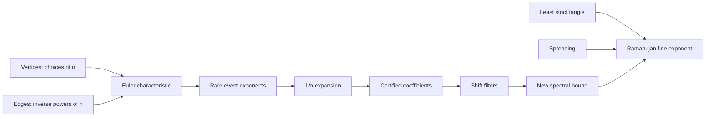

# Intuition at several altitudes

**Label convention.** Mathematical statements from the paper are marked **Paper**. Explanations, analogies, and generated visual maps are **Derived** or **Interpretation**. No generated map is represented as a figure from the paper.

## One sentence

Random high-degree covers shred most non-tree-like cycles into long, spectrally tame structures, and the paper isolates the finitely generated short obstructions called tangles so that trace moments can prove near-optimal new spectral bounds with explicit polynomial exceptional probabilities.

## One paragraph

The new spectrum measures what a cover adds beyond the base. Hashimoto traces turn spectral moments into counts of non-backtracking closed walks. A walk uses roughly $n$ choices for each new vertex and roughly an $n^{-1}$ constraint for each new edge, so graph order $|E|-|V|$ dictates rarity. Raw traces still contain short tangled subgraphs that spoil the coefficient estimates. The certified trace removes walks whose traced graph is spectrally too large, while retaining finite order data. Lengthening the beaded paths of a tame realization keeps it tame, so all length vectors satisfying certification form an upper set. Finite minimal certificates and inclusion-exclusion reduce the sums to tractable convolution pieces. After similar machinery handles tangle-present graphs, subtraction yields the true trace on tangle-free covers. Shift polynomials then eliminate unknown coefficients and identify the $n$-power of exceptional spectral events. Rare strict tangles account for the fine exponent when the base is Ramanujan.

## Five-minute whiteboard version

### Board 1: goal and dictionary

Write:

$$
\lambda=\mu+\frac{d-1}{\mu},
\qquad |\lambda|>2\sqrt{d-1}
\iff \exists\ \text{real }|\mu|>\sqrt{d-1}.
$$

Explain that old eigenvalues are inherited and new eigenvalues have fibre sum zero. The theorem is about the latter.

### Board 2: $1/n$ engine

Write the factorial formula schematically:

$$
\frac{\text{vertex label choices}}{\text{permutation constraints}}
\asymp n^{|V|-|E|}=n^{-\operatorname{ord}}.
$$

Show that order zero cycles have expected count of constant order, while an order-one tangle first appears with probability proportional to $n^{-1}$.

### Board 3: the obstacle

Draw no artificial graph unless useful. Instead write:

$$
\text{raw trace}=\text{finite low-order sums}+\text{error},
\qquad
\text{but unknown coefficients may grow too fast}.
$$

Explain that tangles are the local reason the coefficients get too large.

### Board 4: certified repair

Write:

$$
\text{admit }w
\iff \operatorname{ord}(\operatorname{Graph}(w))<r,
\quad \rho_H(\operatorname{Graph}(w))<R^{1/2}.
$$

Lengthening reduces the dominant spectral radius, so certificates form an upper set. Minimal certificates give finitely many cones. Short and long multiplicities then give $B$-Ramanujan coefficients.

### Board 5: side-stepping and conclusion

Write:

$$
Q(S)=\prod_{\ell\in L}(S-\ell)^D,
\qquad Q(S)\mu^k=Q(\mu)\mu^k.
$$

Unknown coefficient bases vanish. Real exceptions away from base eigenvalues survive with a computable weight. Choose $k\asymp\log n$ and balance the errors. Removing the old trace makes the level-zero coefficient harmless, producing $O(n^{-1})$. For Ramanujan bases, spreading handles near-dominant values and the least strict tangle gives $\eta_{\mathrm{fund}}$.

## The mathematical mechanism

The proof exchanges three kinds of complexity:

| Starting difficulty | Replacement | What becomes checkable |
| --- | --- | --- |
| Non-backtracking walks on infinitely many random covers | Potential walks with factorial probabilities | Exact leading powers of $n$ |
| Infinitely many graph realizations | Finite types plus variable beaded lengths | Polyexponential convolution sums |
| Bad raw coefficient growth | Certified upper sets and finite cone decomposition | Subcritical error after short-long splitting |
| Unknown coefficient polynomials | Shift-operator filters | Eigenvalue localization without coefficient formulas |
| Deterministic base spectrum | Old-trace subtraction | First possible new obstruction at $n^{-1}$ |
| Near-disconnection in Ramanujan refinement | Spreading estimates | Vanishing coefficients below tangle order |

**Derived interpretation.** The main invention is not merely "delete tangles." It is a deletion rule whose admissible length set has an order-theoretic finite presentation and whose retained walks satisfy precisely the growth bound needed by that presentation.

## Geometric and probabilistic intuition

### Walk geometry

For a fixed base walk, following it upstairs is like reading values of fresh random permutations. Reaching a new vertex is easy. Returning to an already visited vertex at an unrevealed permutation value requires a coincidence and costs approximately $k/n$. Excess independent cycles in the traced graph increase the number of coincidences and hence the order. This is why negative Euler characteristic equals rarity.

### Path lengthening

Replacing an edge by a longer beaded path spreads non-backtracking motion over more steps. Spectral walk growth per step decreases or stays controlled under the variable-length monotonicity used by the paper. Thus a tame local shape remains tame after lengthening. This is the entire reason certified vectors form an upper set.

### Small graph example, Derived

A cycle has $V=E$, so $\chi=0$. Its expected occurrence count is therefore of order $n^0$, which matches the familiar intuition that fixed-length short cycles occur with bounded expectation in large permutation models. A tree has $\chi=1$, but a strictly non-backtracking closed walk cannot trace a tree, so closed-walk theory concentrates on pruned graphs.

A theta graph with two vertices and three internally disjoint paths has $\chi=-1$ before subdivision. In the special case of three parallel edges, each directed Hashimoto transition has two non-backtracking continuations, hence dominant radius $2$. Its order is $1$, and when it is feasible and strict relative to the base threshold it contributes at scale $n^{-1}$. This example explains both the spectral tangle criterion and the probability exponent without requiring a picture.

### Rare-event meaning of $\eta_{\mathrm{fund}}$

One copy of a fixed order-$s$ strict tangle has probability proportional to $n^{-s}/|\operatorname{Aut}|$ under the pruned hypotheses. Larger tangles and repeated copies appear only at higher powers of $n^{-1}$. The first bad spectral scale is therefore combinatorial, not a mysterious analytic constant.

## Algorithmic intuition

1. **Generate a candidate base walk and trajectory.**
2. **Compute its traced graph and order.**
3. **Discard it into the usual remainder if its order reaches $r$.**
4. **Compress degree-two paths to obtain its type and restore its form.**
5. **Test certification by the spectral radius of the realization.**
6. **Use minimal certificate vectors to choose cone regions.**
7. **Sum local base-walk matrix statistics by weighted convolution.**
8. **Repeat with a forced tangle graph when required by Möbius inversion.**
9. **Apply shift polynomials along several consecutive lengths.**
10. **Select logarithmic $k$ to make the remaining terms polynomially small in $n$.**

Proposition 3.3.3 then uses a different algorithmic task: enumerate finitely many candidate tangles and decide strict spectral comparisons algebraically. Finite computability here is not the same as practical efficiency.

## What is surprising?

- **Hashimoto first can be stronger than adjacency first.** The quadratic mapping creates enough structure to make non-backtracking traces useful rather than merely technically convenient.
- **A weaker error class simplifies the proof.** Allowing $(R^{1/2}+\varepsilon)^k$ for every $\varepsilon$ avoids delicate exchange of polynomial prefactors between factors.
- **A strict inequality helps combinatorics.** Certified non-tangles use a strict radius cutoff and form an upper set even though strict tangles themselves are less convenient under graph limits.
- **Finite minimal certificates exist in every fixed type.** The admissible set is infinite and geometrically irregular, yet finite cone sums suffice.
- **The first coefficient need not be computed.** Side-stepping turns its vanishing into an event estimate without finding its formula.
- **Small components and tangles play different roles.** Spreading handles one, certification handles the other.

## What would naive baselines do?

### Baseline A: expected full adjacency trace at one logarithmic moment

It confronts arbitrary backtracking walks, difficult multiplicities, and dominant base terms. Even Hashimoto improvement alone does not control every high-order coefficient.

### Baseline B: expected raw Hashimoto trace with an asymptotic expansion

This is better, but raw coefficients can fail to be $B$-Ramanujan at sufficient order. Tangles force additional exponential growth. Choosing a single $k$ cannot safely side-step unknown coefficients.

### Baseline C: condition on tangle-freeness and use raw trace

The paper explicitly notes that its methods do not establish the desired vanishing coefficients for this conditional expectation. The successful path multiplies by a tangle-free indicator after proving total and tangle-present certified expansions, rather than merely conditioning and hoping the coefficients simplify.

### Baseline D: discard all large spectral events without probability accounting

This silently loses tangle-containing graphs. The complete conclusion requires the finite tangle-event bound as well as side-stepping on the tangle-free event.

## Visual reading integrated into the intuition

**Direct inspection result.** The paper supplies no mathematical pictures to offload this intuition into. It is a text-and-display argument. Its visual logic is carried by four formulas rather than by plots:

1. **List of Symbols:** separate the spectral target from the walk machinery. The ordering is itself a reading map.
2. **Equation (2.21):** read numerator factorials as label abundance and denominator factorials as edge scarcity. Together they create $n^\chi$.
3. **Equation (2.39):** read $\mathbf k\ge\mathbf k_0$ as a cone, not just as an arbitrary lower bound. It is the visible residue of finite certification.
4. **Equation (2.57):** read the left side as random spectral moments and the right side as a structured expansion plus error. Side-stepping applies an operator across this equality.

**Derived visual distinction.** Red boxes around "certified trace," references, and glossary entries are hyperlinks or glossary markup. Green and cyan citation styling does not signal importance. Important equations were selected by their logical role, not by colored decoration.

**No missing figure analysis.** The names figure 8, barbell, and theta in Subsection 1.3.5 describe graph shapes verbally, but the authors include no illustrations. The dossier uses their Euler characteristic and degree descriptions instead of inventing source-image claims.

## A mental dependency image

The following is a generated reading aid, not a paper visual:

## Defensible takeaway

The clean mental model is robust, but the manuscript's notation needs active checking. In particular, replace any full-radius reading of Theorem 3.3.2 with the required new-radius statement, treat Section 2.7's parameter powers as inconsistent prints, and do not quote Theorem 3.3.4's universal inequality after the $W_2$ counterexample. These defects affect how a reader reconstructs the argument, but they do not erase the clear structural contribution of certified traces.
